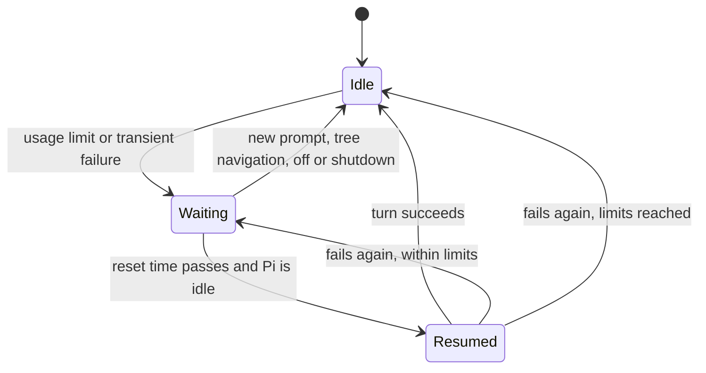

# pi-auto-resume

Continues a Pi session automatically after a provider usage limit resets or a transient provider failure.

## Install

Run `pi install git:github.com/mich-murphy/pi-extensions`, or [load only some extensions](../../README.md#install). Auto-resume is on by default.

## Commands

| Command | Effect |
| --- | --- |
| `/auto-resume` | Toggles auto-resume for this session. |
| `/auto-resume on` | Turns it on. |
| `/auto-resume off` | Turns it off and cancels any pending wait. |

Any other argument shows `Usage: /auto-resume [on|off]` and changes nothing.

## Configuration

Add an `autoResume.transient` object to `~/.pi/agent/settings.json`, or to a project's `.pi/settings.json`. Every field is optional. An invalid field makes Pi warn once and use all defaults.

| Field | Default | Effect |
| --- | --- | --- |
| `enabled` | `true` | `false` stops transient retries; usage-limit waits continue. `/auto-resume off` stops both. |
| `delaysMinutes` | `[1, 2, 5, 10, 15]` | Wait before each attempt. The last value repeats. Values are positive and may be fractional. |
| `maxAttempts` | `8` | Retries before Pi gives up. Positive integer. |
| `windowMinutes` | `120` | No retry starts later than this long after the first failure. |

## How it behaves

When a run ends on a failure, Pi omits the failed attempt from model context, shows a warning and a widget above the editor, and checks the clock every minute. Once the time passes and Pi is idle, it starts a new turn with a marker message.

- **Usage limit:** waits if the provider publishes a reset time on the `usage-limit` event channel and it is at most 5 hours away. `pi-claude-sdk` publishes one; other providers get transient retries only.
- **Transient failure:** applies after Pi's own retries fail. Aborted runs, authentication errors, invalid requests and context overflow are not retried. After `maxAttempts` retries, or once `windowMinutes` have passed since the first failure, it stops and asks you to send a message.

Modes differ:

| Mode | Behavior |
| --- | --- |
| TUI, RPC | Waits and resumes. |
| Print | Writes `Usage limit resets at <ISO time>` to stderr and exits. |
| JSON | Records an `auto-resume` custom entry with `{ resetsAt }` and exits. |

## Limitations

- The wait lives in memory and ends with the Pi process.
- The provider's reset-time event names no request. If another call to the same provider hits a limit during the final request, its reset time can be applied to the wrong failure.
- Waiting does not keep the machine awake, and `pi-caffeinate` releases while Pi is idle. After the machine wakes, the next minute check resumes on schedule.
