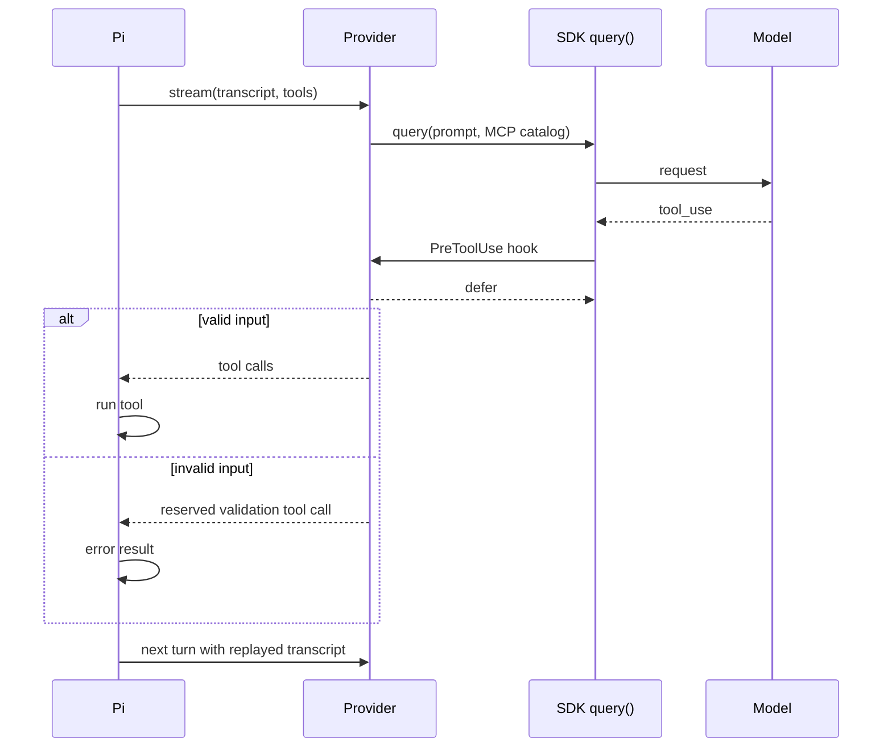

# Architecture

This page explains how `pi-claude-sdk` turns Pi model calls into Claude Agent SDK queries. For setup, see the [README](../README.md).

## How a turn works

Pi stays the coding harness. It owns the conversation, tools, approvals and cancellation. For each model turn the provider:

1. Replays Pi's transcript into one prompt, with one content block per entry.
2. Opens an SDK `query()` with a short bridge system prompt, Pi's working instructions and Pi's tool catalog.
3. Reads messages until the first `result`, then aborts the query.
4. Returns either text or the tool calls Claude requested.

The SDK keeps no session, so each turn is stateless. A query has an eight-turn safety cap, and reaching it fails the turn with a typed error.

## Tool bridge

The provider advertises each Pi tool through an in-process MCP server with its real input schema. Only the tools Pi currently declares appear. A tool whose JSON Schema uses an unsupported keyword gets a permissive schema, and Pi still validates its arguments.

- **`PreToolUse` defer.** The hook validates input with Pi's validator and returns `permissionDecision: "defer"`. The query ends with a deferred result, and the provider hands the calls to Pi. The MCP handlers are only a fallback: if one runs, the turn fails with `tool-contract`.
- **`PostToolBatch`.** The hook catches tool calls that resolved without deferral. It turns them into non-executing corrections and stops the query before another model request. Genuine failures, cancellation and a missing result fail the whole turn and release no calls.
- **Validation recovery.** Invalid input, unexpected tools and tool calls printed as text become calls to the reserved tool `pi_claude_sdk_validation_error`. It never runs real code. Pi records an error result with fixed correction text and asks the model again. An unconditional `tool_call` guard blocks the reserved name.

Later turns collapse a reserved call and its result into one fixed text note. Replaying the call verbatim would teach the model to call an undeclared tool.

SDK tool names are `mcp__pi__<name>`, or `mcp__pi__pi_<hash>` for names the SDK cannot carry.

## Isolation from host config

Each query sets `settingSources: []`, `tools: []`, `strictMcpConfig: true` and `skills: []`. Claude Code reads no settings, `CLAUDE.md`, hooks, built-in tools, user MCP servers or skills. It runs with `permissionMode: "dontAsk"` and allows only `mcp__pi__*`. Hooks use `onFailure: "block"`, so a failing hook stops the turn. The provider also sets Claude Code options that leave memory, compaction and tool search to Pi, and removes API-key and cloud-provider variables.

## Replay format

Each transcript entry becomes a tagged block: `<user>`, `<assistant>` with `<call>` tags, and one `<results>` block holding a `<result>` per call. Bodies are not JSON-escaped. Structural tag names inside content are rewritten so content cannot forge a boundary. Errored and aborted assistant messages are skipped, and a call with no result gets an error result. Calls to tools missing from the current catalog render as `past-call` and `past-result`. Pi only appends, so earlier entries render identically on every turn.

## Prompt caching and breakpoints

The provider places up to four `cache_control` breakpoints, never on the closing "Continue" block:

- on the preamble (tools, bridge prompt and Pi instructions);
- on the previous request's tail, where the last turn wrote;
- on the newest entry;
- on an intermediate entry when more than 20 blocks separate two breakpoints, because Anthropic searches only 20 blocks back.

The provider sets `DISABLE_PROMPT_CACHING=1` so Claude Code adds no breakpoints of its own and the request stays within the four-breakpoint limit. `PI_CLAUDE_SDK_CLI_CACHE=1` restores Claude Code's policy. Retention follows `cacheRetention`, then `PI_CACHE_RETENTION`. A change to the system prompt or tool set costs one prefix rewrite. A fixed session title stops Claude Code sending an uncached titling request. Use [diagnostics](diagnostics.md) to tell a local prefix change from an upstream miss.

## Error-text privacy

The provider discards raw SDK `errors` and `result` prose. It does not redact or truncate it. Only allowlisted structured fields (terminal reasons, result subtypes, typed API errors) produce short synthetic messages. Explicit terminal categories outrank earlier generic API errors, except authentication, so `prompt_too_long` stays recognisable to Pi's context-overflow recovery. Unknown reasons become `unrecognized` in diagnostics, and unknown stop reasons fail with a value-free `protocol` error. A `rate_limit` error is a `usage-limit` only when the same query reported a rejected window.

## Model routing

Current models send a Claude Code moving alias (`sonnet`, `opus`, `haiku`). `claude-5.2-fable` sends the full ID `claude-fable-5-2`, because the `fable` alias still resolves to Fable 5.1 in Claude Code 2.1.319. `claude-4.5-haiku` sends the full ID `claude-haiku-4-5`. Any other ID passes through unchanged, so custom IDs keep working. Aliases can move without a code change.

Every turn records the concrete model from the SDK's `message_start`. `/claude-sdk-status` prints each advertised ID, its selector and the last observed model, and flags a model that differs from the expected one. The live upgrade gate checks the same resolutions, context windows and output limits. See [SDK upgrade](sdk-upgrade.md).
