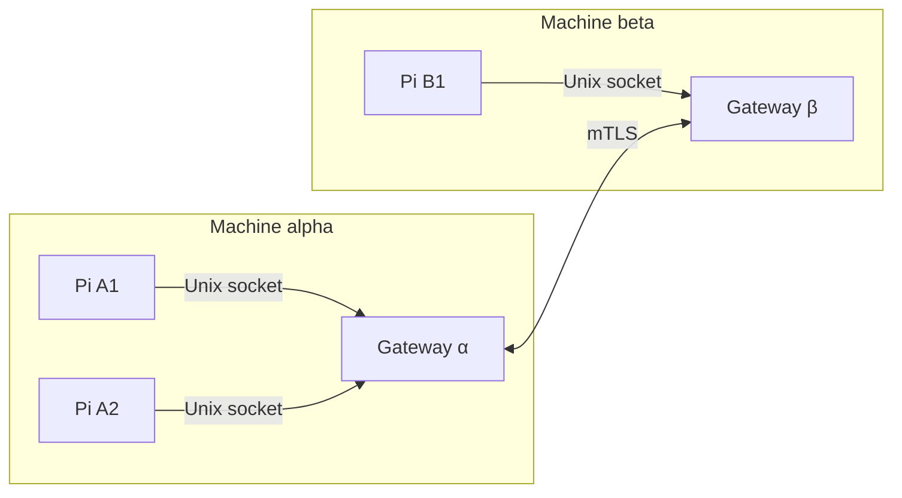

# pi-comms

Lets live Pi sessions send each other messages, on one machine or across machines.

pi-comms does not export transcripts, transfer files, apply patches or run tasks on a peer. Messages are authored by the model or user. Nothing starts a gateway for you, and nothing is stored when a session ends.



Every session connects to its machine's gateway, including two sessions on the same machine.

## Install

You need a clone of this repository and a Rust toolchain to build the gateway. `nix develop` in the clone provides one.

1. Install the extension:

   ```sh
   pi install git:github.com/mich-murphy/pi-extensions
   ```

   To [load only some extensions](../../README.md#install), see the root README.

2. Build the gateway from the clone:

   ```sh
   cd packages/pi-comms/gateway && cargo build --locked --release
   ```

3. Create a private directory for the socket, such as `mkdir -m 700 ~/pi-comms`. Write a gateway config, `~/pi-comms/gateway.json`. It has the same fields as the Pi config below, without `label`. See the [gateway reference](gateway/README.md#configuration) for its limits.

4. Start the gateway and leave it running. It prints a `ready` line once it is listening:

   ```sh
   ./target/release/pi-gateway --config /home/me/pi-comms/gateway.json
   ```

5. Write the Pi config below, then run `/reload` in each Pi session.

## Configure

Pi reads `session-communication.json` from its agent directory, `~/.pi/agent` by default. It never reads the project. Without the file the extension stays off. The file must be 32 KiB or smaller, and unknown keys are rejected.

```json
{
  "machineId": "workstation",
  "socketPath": "/home/me/pi-comms/gateway.sock",
  "scopeIds": ["team"],
  "label": "Engineering session",
  "policies": [
    {
      "machineId": "workstation",
      "scopeId": "team",
      "permissions": ["discover", "read", "push", "interest"]
    }
  ]
}
```

| Field | Required | Constraint | Purpose |
| --- | --- | --- | --- |
| `machineId` | yes | `^[a-z][a-z0-9-]{0,31}$` | Name of this machine. |
| `socketPath` | yes | Absolute, 100 bytes or fewer (the gateway's limit), no control characters | The gateway's Unix socket. |
| `scopeIds` | yes | 1–4 unique values matching `^[A-Za-z0-9_-]{1,64}$` | Groups this session joins. |
| `label` | yes | 1–128 bytes, no control characters | Display name for peers. Keep paths and transcript text out. |
| `policies` | yes | 256 or fewer entries | Which machines may do what in which scope. |
| `policies[].machineId` | yes | Same pattern as `machineId` | Machine the grant applies to. |
| `policies[].scopeId` | yes | Scope pattern | Scope the grant applies to. |
| `policies[].permissions` | yes | Any of `discover`, `read`, `push`, `interest` | Allowed actions. |

## First call

Start two Pi sessions on the same machine. Both use the same config and gateway. In one, ask the model: "Call `session_peers` for scope `team`." The other session appears in the result with its `PeerRef`: the `machineId`, `sessionId` and `runtimeNonce` that address that exact session. Then ask the model to send it a message with `session_send`. The receiving session is woken and reads it with `session_take`.

## Tools

| Tool | Parameters | Purpose |
| --- | --- | --- |
| `session_peers` | `scopeIds?` (1–4), `watch?` | List live sessions you may discover. |
| `session_send` | `to` (PeerRef), `scopeId`, `message` (`kind`, `content`, `format`, `work?`, `status?`, `refs?`, `replyTo?`) | Send a request, reply or update to one session. |
| `session_take` | `limit?` (1–8, default 4) | Move messages from your inbox into the conversation. |
| `session_state` | `action` (`get`, `list`, `put`, `remove`), `publisher`, `scopeId`, `key`, `expectedRevision?`, `record` | Read peers' publications or manage your own. |
| `session_interest` | `action` (`add`, `remove`), `publisher`, `scopeId`, `work` | Subscribe to a peer's work updates. |
| `session_report` | `scopeId`, `key`, `record`, `notify` (`interested`, `selected`), `recipients?` (1–8) | Publish a work report and push it to recipients. |

`format` is `text`, `markdown`, `git-diff` or `git-format-patch`. All formats are descriptive; nothing is applied or fetched.

## Commands

`/session-communication [status|reconnect]` shows status (the default) or starts one bounded reconnect to the gateway.

| Message | Meaning |
| --- | --- |
| `Session communication: not enabled · (no user-agent session-communication.json)` | The config file is missing. |
| `Session communication: not enabled · configuration or startup failed` | The file is invalid or the runtime failed to start. |
| `Session communication: not enabled · runtime unavailable` | No runtime is running. |
| `Session communication: enabled · …` | Also lists your identity, scopes, watch state, inbox, receipts, publications and wake notice. |
| `Session gateway unavailable; no admitted work was replayed…` | `reconnect` failed. |

## Limits

| Limit | Value |
| --- | --- |
| Frame size | 32 KiB |
| Message `content` | 24,576 characters, and 24 KiB of authored data per frame |
| `refs` per message | 8 |
| Inbox | 64 messages, 1 MiB |
| Receipts kept | 1,024, for at least 10 minutes |
| Publications | 16, 512 KiB |
| Relations and interests | 256 |
| Recipients per report | 8 |
| Sessions per gateway | 30 |
| Send attempts | 3 within 15 seconds |

## Delivery receipts

- `admitted`: the receiving session's inbox holds the message. It does not mean read, accepted or done.
- `not_admitted`: the attempt is known not to have been admitted.
- `unknown`: it may have been admitted. The adapter retries with the same `message.id`; do not resend the work as a new message.

See [design](docs/design.md#receipts-and-idempotency).

## Use from codemode

- Start with discovery and publication listing and reading. Keep full `PeerRef`s and revisions for later calls.
- Call simple reads, `session_take` and single sends directly.
- Do not rebuild `session_report` in a script.
- Never rerun sends or reports after a script fails. Cancelling a script does not undo effects.
- `session_take` consumes the inbox. A later script failure does not restore it.

## More

- [Connect two machines](docs/remote-setup.md)
- [Gateway reference](gateway/README.md)
- [Design](docs/design.md)
