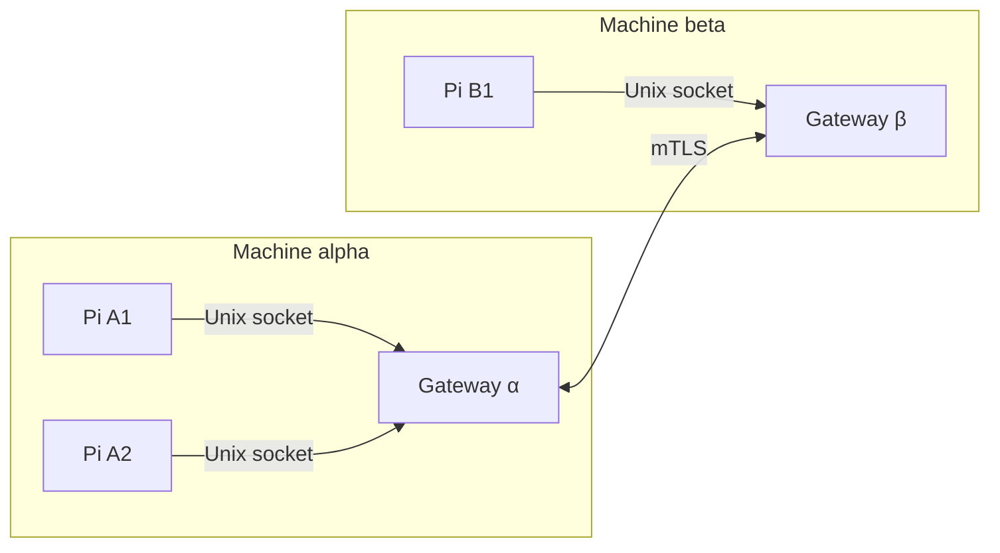

# pi-comms

Lets live Pi sessions send each other messages, on one machine or across machines.

pi-comms does not export transcripts, transfer files, apply patches or run tasks on a peer. Messages are authored by the model or user. Loading an unconfigured extension is inert. After reviewed setup, participating Pi sessions start a detached shared gateway on demand. Session inboxes/publications are volatile; setup choices and credential/floor state remain on disk.



Every session connects to its machine's gateway, including two sessions on the same machine.

Same-machine grants apply across projects on the OS account, not just within a repository. Only explicitly published records are readable; files and whole transcripts are not automatically shared. Authorized new messages can wake a model and incur provider usage. Peer messages are untrusted content.

## Install

Install the extension:

```sh
pi install git:github.com/mich-murphy/pi-extensions
```

To [load only some extensions](../../README.md#install), see the root README.
Run `/comms setup` in a terminal UI or attended RPC client. Choose local-only or
one remote peer, review the inferred machine identity, `local` scope, `Pi` label
and grants, optionally Edit or inspect paginated Details, then select **Apply**.
Escape, Cancel, an invalid RPC answer or a 120-second unanswered dialog makes no
setup writes, downloads or gateway starts before Apply. Print/JSON setup/reset
refuse mutation; there is no unattended `--yes` bypass.

**Acquisition gate:** this source tree ships no reviewed immutable gateway source
or published artifact-manifest pin. Fresh production Apply therefore reports
**Blocked**, without writing configuration or choosing a project/PATH binary.
Once reviewed pins are supplied, acquisition prefers Nix with a private dedicated
result, then the separately reviewed verified native fallback if available. A
previously installed, hash-verified setup executable can be reused. A local test
binary is not a production acquisition route.

For manual operation before that distribution gate is resolved:

1. Build from a trusted checkout using `cd packages/pi-comms/gateway && cargo build --locked --release` (`nix develop` provides the toolchain).
2. Create a private persistent socket directory and gateway configuration. It has the Pi fields below without `label`; see the [gateway reference](gateway/README.md#configuration).
3. Start `pi-gateway --config /absolute/path/to/gateway.json` yourself.
4. Write the Pi configuration below and run `/comms reconnect` to activate an absent runtime. Existing custom/external/symlink configurations are preserved; guided setup does not silently adopt or migrate them.

Setup-managed gateways run without launchd/systemd definitions: the first
participating Pi starts the singleton; the last closes it after a bounded grace.
Closing one Pi never kills the shared process. A crash while Pis remain open
triggers bounded reconnect-or-spawn/re-registration episodes, keeping their nonce,
publications and inbox state and never replaying uncertain sends. Exhaustion is
reported; the next explicit reconnect or tool call can start another bounded
episode, not a perpetual background retry.

The socket/managed ownership lock live under canonical home
`.pi/comms/<agent-directory-hash>/s` in private owned directories. Paths must fit
100 UTF-8 bytes. An overlong home requires an explicitly reviewed short persistent
private location, never a silent temporary-path fallback. Intentionally separate
agent profiles have separate gateways; ordinary sessions sharing an agent
directory share one. This is same-account trust across projects, not isolation
from root or other code running as that account.

## Configure

Pi reads `session-communication.json` from its agent directory, `~/.pi/agent` by default. It never reads the project. Without the file the extension stays off. The file must be 32 KiB or smaller, and unknown keys are rejected.

```json
{
  "machineId": "workstation",
  "socketPath": "/home/me/pi-comms/gateway.sock",
  "scopeIds": ["team"],
  "label": "Engineering session",
  "policies": [
    {
      "machineId": "workstation",
      "scopeId": "team",
      "permissions": ["discover", "read", "push", "interest"]
    }
  ]
}
```

| Field | Required | Constraint | Purpose |
| --- | --- | --- | --- |
| `machineId` | yes | `^[a-z][a-z0-9-]{0,31}$` | Name of this machine. |
| `socketPath` | yes | Absolute, 100 bytes or fewer (the gateway's limit), no control characters | The gateway's Unix socket. |
| `scopeIds` | yes | 1–4 unique values matching `^[A-Za-z0-9_-]{1,64}$` | Groups this session joins. |
| `label` | yes | 1–128 bytes, no control characters | Display name for peers. Keep paths and transcript text out. |
| `policies` | yes | 256 or fewer entries | Which machines may do what in which scope. |
| `policies[].machineId` | yes | Same pattern as `machineId` | Machine the grant applies to. |
| `policies[].scopeId` | yes | Scope pattern | Scope the grant applies to. |
| `policies[].permissions` | yes | Any of `discover`, `read`, `push`, `interest` | Allowed actions. |

## First call

Start two Pi sessions on the same machine. Both use the same config and gateway. In one, ask the model: "Call `session_peers` for scope `team`." The other session appears in the result with its `PeerRef`: the `machineId`, `sessionId` and `runtimeNonce` that address that exact session. Then ask the model to send it a message with `session_send`. The receiving session is woken and reads it with `session_take`.

## Tools

| Tool | Parameters | Purpose |
| --- | --- | --- |
| `session_peers` | `scopeIds?` (1–4), `watch?` | List live sessions you may discover. |
| `session_send` | `to` (PeerRef), `scopeId`, `message` (`kind`, `content`, `format`, `work?`, `status?`, `refs?`, `replyTo?`) | Send a request, reply or update to one session. |
| `session_take` | `limit?` (1–8, default 4) | Move messages from your inbox into the conversation. |
| `session_state` | `action` (`get`, `list`, `put`, `remove`), `publisher`, `scopeId`, `key`, `expectedRevision?`, `record` | Read peers' publications or manage your own. |
| `session_interest` | `action` (`add`, `remove`), `publisher`, `scopeId`, `work` | Subscribe to a peer's work updates. |
| `session_report` | `scopeId`, `key`, `record`, `notify` (`interested`, `selected`), `recipients?` (1–8) | Publish a work report and push it to recipients. |

`format` is `text`, `markdown`, `git-diff` or `git-format-patch`. All formats are descriptive; nothing is applied or fetched.

## Commands

| Command | Behavior |
| --- | --- |
| `/comms` or `/comms status` | Current exact runtime identity and bounded accounting; native remote diagnostics are a disk snapshot, not proof of a live link. |
| `/comms setup` | Native intent/review/Edit/Apply; resumes pairing, repairs an unavailable owned installation, adds a peer to an owned local setup, or diagnoses/preserves external configuration. |
| `/comms doctor` | Bounded regular-file inspection, including valid config symlinks read-only. Never binds/connects to a gateway or writes configuration/floors. |
| `/comms reconnect` | Bounded ensure/re-registration. Existing runtimes keep nonce/state and do not replay uncertain sends; an absent runtime can load valid configuration and activate directly. |
| `/comms reset` | Reviewed disable of unchanged setup-owned participation, reversible configuration backups and resumable owned archives. Preserves executable, keys, CRLs, revocation floors and old pair generations. Never signals the shared gateway. |

Managed setup requires the `config-generation-v1` capability. Each connection
attempt sends the expected SHA256 from that attempt's verified setup snapshot;
the gateway admits it only when those are the exact config bytes loaded by its
managed process. A reachable socket alone is not activation proof. Manual clients
without a managed ensure callback retain legacy registration without the field.
There is no unguarded fallback if an older gateway rejects the field or closes.
This fingerprint does **not** attest PKI-content freshness or remote link readiness;
supported pairing updates select new immutable credential-generation paths.

Fresh Apply discloses an already-present shared socket using read-only inspection
(no pre-Apply connect), saves the reviewed configuration, and sends at most one
machine-bound restart request when that prior socket was observed. An uncertain
restart, generation mismatch or failed guarded admission reports **configuration
saved; activation pending/unconfirmed**, not connected. Surviving old sessions may
still use old trust until the old gateway exits. An old instance appearing after
the review snapshot is also blocked by guarded admission, not silently adopted.

`/comms reconnect` and passive recovery only retry guarded admission within the
existing bounded episode (six attempts / sixty seconds); they never send restart
control or replay application requests. To explicitly retire an old instance, use
`/comms setup` → **Activate saved configuration**, review, then Apply. This sends
one separate user-approved restart and reconnects the same Pi runtime: nonce,
inbox, publications, interests and receipts are retained. Incompatible survivors
with narrowed identity/scope/grants remain refused. A cancelled action does
nothing; uncertain control is never automatically replayed.

`/session-communication [status|reconnect]` remains a compatibility alias.
Reconnect is not a blanket `/reload`: it does not replace an existing runtime's
adapter policy snapshot. Maintenance reloads compatible setup metadata for the
launcher while retaining the Pi's identity/state. Adding remote grants explicitly
reviews replacement of **this** Pi runtime and loss of its inbox, publications,
interests and receipts. Other already-open Pis keep their conservative earlier
adapter grants; they do not automatically gain the new remote permissions.

Missing configuration on disk does not prove an old runtime is disabled. Reset
closes this Pi's runtime after disabling owned disk configuration; other running
Pis are not silently replaced. Unknown/custom/symlink configuration or changed
ownership hashes fail closed without overwriting external bytes. Interrupted
Apply/reset reports retained effects; retry reset only for an owned recovery
ledger. The native permanent flock releases on holder EOF/crash and is never
removed as a stale PID file.

If a setup-owned executable disappears (including Nix GC) or its bytes/type change,
`/comms setup` offers an explicit **installation repair**, not an automatic update.
Inspection never executes the broken file: symlinks, FIFOs/devices and oversized
files fail promptly. Cancel does not acquire or write. Reviewed Apply uses a fresh
trusted acquisition route, then the verified new helper's native lock and CAS to
update only installed/executable metadata. Configuration, keys, floors and old
unknown files are retained; existing Pi runtimes keep nonce/state. An interrupted
metadata update has a resumable repair ledger; finish it with setup before reset.
Externally changed adapter/gateway/pairing bytes refuse repair. With no trusted
catalog pin, repair is honestly blocked just like a fresh install; it never falls
back to executing the broken file or choosing a project/PATH binary.

For remote peers, use [guided pairing and maintenance](docs/remote-setup.md).
Native existing-material import preserves a live existing floor and generates a
public renewal request, but does not adopt external issuer custody. Its signer
and update bundle must match the imported runtime's exact pair/offer binding;
arbitrary external-CA renewal is not automated or proven by guided import.
A local connected result does not claim a remote link. Expired/bad remote
credentials degrade the remote side while leaving local communication available.
Unknown sends must never be resent as a new message ID.

## Limits

| Limit | Value |
| --- | --- |
| Frame size | 32 KiB |
| Message `content` | 24,576 characters, and 24 KiB of authored data per frame |
| `refs` per message | 8 |
| Inbox | 64 messages, 1 MiB |
| Receipts kept | 1,024, for at least 10 minutes |
| Publications | 16, 512 KiB |
| Relations and interests | 256 |
| Recipients per report | 8 |
| Sessions per gateway | 30 |
| Send attempts | 3 within 15 seconds |

## Delivery receipts

- `admitted`: the receiving session's inbox holds the message. It does not mean read, accepted or done.
- `not_admitted`: the attempt is known not to have been admitted.
- `unknown`: it may have been admitted. The adapter retries with the same `message.id`; do not resend the work as a new message.

See [design](docs/design.md#receipts-and-idempotency).

## Use from codemode

- Start with discovery and publication listing and reading. Keep full `PeerRef`s and revisions for later calls.
- Call simple reads, `session_take` and single sends directly.
- Do not rebuild `session_report` in a script.
- Never rerun sends or reports after a script fails. Cancelling a script does not undo effects.
- `session_take` consumes the inbox. A later script failure does not restore it.

## More

- [Connect two machines](docs/remote-setup.md)
- [Gateway reference](gateway/README.md)
- [Design](docs/design.md)
