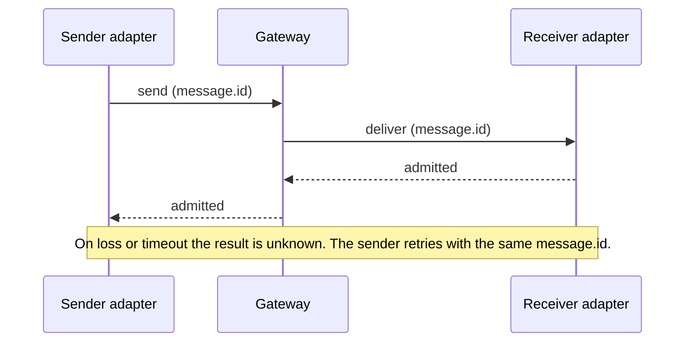

# Design

pi-comms keeps message delivery small and explicit. A gateway only routes. Each Pi session's adapter owns the inbox, receipts and publications, all in memory.

## Receipts and idempotency

`message.id` is the idempotency key. Its namespace is the exact sender, recipient and scope. The adapter creates one id per `session_send` call and keeps every authored field unchanged across at most three attempts within 15 seconds. Only the attempt id, `rid`, changes.

| Receipt | Meaning |
| --- | --- |
| `admitted` | The receiver's volatile inbox holds the message. Not read, accepted or completed. |
| `not_admitted` | The attempt is known not to have admitted it. |
| `unknown` | It may already be admitted. A later rejection does not erase that doubt. |

A repeat with the same id and content returns the original receipt without a second enqueue or wake, even when the inbox is full. The same id with different content returns `id_conflict`. A receipt is kept for at least 10 minutes from first admission, and for as long as its payload is still in the inbox. After it expires, a late duplicate can be admitted again, so this is not permanent exactly-once delivery.

## PeerRef

A `PeerRef` is `machineId`, Pi's `sessionId` and a random `runtimeNonce`. The nonce changes whenever Pi reloads, starts a new session, forks or resumes. A send to an old nonce fails instead of reaching the replacement. A gateway reconnect keeps the identity and the in-memory state. Short identities in the UI are display hints only.

## Inbox, wake and take

Pi has no public way to know when a custom message it queued was actually consumed. Retiring it on `agent_settled` or `hasPendingMessages()` is unsafe: after Escape clears Pi's queue, a message that arrives during the abort stays queued even though both signals say idle. Releasing its charge would undercount. Keeping every unsure message charged would eventually fill the adapter. So message bodies never enter Pi's queue.

- The adapter keeps authored messages in its own bounded inbox.
- A new admission asks for a wake: one constant notice, never the message.
- `session_take` moves a batch of up to 8 messages into the conversation. It frees their inbox slots but keeps their receipts.

Wake rules:

- **Idle:** one notice goes out at once through `sendMessage` with `triggerTurn`. At most one notice is outstanding. Only its own `message_end` clears it, not a take, a timeout or settling. A notice that never shows up stays at one and the status reports it as `degraded_unobserved`.
- **Busy:** the adapter never sends. It records one pending wake. At the next `agent_before_settle` the pending wake becomes one notice and the run continues. Several arrivals share one notice.
- **Settled:** pending wake intent is cleared.
- **Compaction:** after a manual compaction succeeds or fails, one deferred check wakes the model if Pi is idle and a wake is pending. There is no polling.

Escape is Pi's own cancel. An aborted run skips `agent_before_settle`, so old messages are not announced again. Abort does not replay anything, restore text, mute peers or cancel remote work. Messages stay in the inbox until a take. Only a new authorized push can wake a later turn. Publication reads, discovery, control traffic and duplicates never wake anyone.

Admission is not consumption. Replacing the runtime discards the inbox, publications and interests, and there is no offline mailbox.

Local tools do not wait on gateway recovery. While the gateway is unreachable, `session_take` still returns already-admitted messages, and `session_state` `put`/`remove` still change this runtime's own private publications in configured scopes. While connected, those writes are limited to the scopes the gateway granted. Offline, the limit is the configured scopes, so a write can land in a configured scope that the last registration did not grant. Writes made while offline are not exposed until a later registration grants that scope and the read policy allows the reader. When both hold, peers can read them with no further action. Local tools never start recovery. After the bounded automatic reconnect episode gives up, the runtime stays disconnected until a remote tool runs its recovery preflight or `/comms reconnect` succeeds, and until then its publications stay unreadable and it receives no new deliveries. Remote reads, discovery, sends, interests and reports keep the guarded recovery preflight and fail closed.

## Trust model

- Gateways talk over TLS 1.3 only, with mutual authentication. Session resumption and early data are off.
- Trust is one private CA you create. There are no system roots and no pinned leaves.
- A leaf must have exactly one DNS SAN, `gateway.<machineId>.pi.internal`. The address you dial is not an identity.
- Each issuer needs one complete CRL with a future `nextUpdate`. Delta, partitioned and indirect CRLs are rejected.
- Each gateway stores the highest CRL number it has seen per issuer in a revocation floor file. It refuses older or conflicting CRLs, even after a restart.
- Links need a correct clock. A link ends at the earliest certificate or CRL expiry, or after 24 hours. Every configured root must be currently valid, used or not.
- The local socket trusts the same user account, not individual processes.
