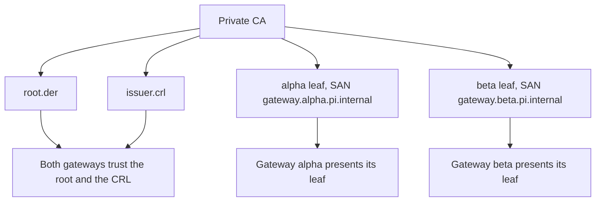

# Connect two machines

Link two gateways, `alpha` and `beta`, over mutual TLS with a private CA. One gateway listens and the other connects.



Both machines need a correct clock and an installed pi-gateway. Native pairing
requires neither OpenSSL nor a third signer. The manual recipe below additionally
uses OpenSSL 3 and a local Rust/Nix build.

## Native pair setup

Use the gateway's `pair OP --input ABS_JSON` commands, or the extension's guided
setup when available. [The exact input/output contract](../gateway/PAIRING.md)
includes every JSON field and the returned configuration paths. Exchanges are
public-only bounded data; never paste private keys into Pi, a model or a transcript.

| Step | Host | Action |
| --- | --- | --- |
| Create | Initiator | create names exactly two machines, creates a separate issuerDir and runtimeDir, and returns public offerPath/rootSha256 plus its credential paths. |
| Join | Peer | Independently confirm the full root SHA256 out of band; join generates the peer key and signed CSR locally. Transfer only the public request. |
| Issue | Initiator | Independently confirm the peer's full request SHA256 out of band, then issue its leaf and numbered CRL. Transfer the public bundle. |
| Import | Both | Initiator imports with floorMode=existing; pending peer imports with floorMode=new. Use the returned paths, not assumed filenames. |
| Activate | Both | Under the native setup lock, write the gateway config and request a machine-bound managed restart. Reconnect/verify local registration and remote link separately. |

The initial directories must not exist and their parent must be private (0700).
Generated files are 0600. The issuer key is pair-specific and stays outside runtime
files; it is never loaded by the running gateway. A separate directory is **not**
protection from code running as the same Unix account. Optionally offload the entire
issuer directory to protected offline storage after provisioning. No mandatory
third host is involved. Reusing the root for unrelated peers is unsupported.

Leaves last 90 days, CRLs 30 days, roots 365 days. inspect reports public root/leaf/CRL
expiry and warns at seven days to the earliest bound. Before expiry, renew on the
custody host using the original pinned signed request and independently confirmed
full request hash, then transfer/import on both hosts. Renewal reuses local keys;
key replacement is not an implicit renewal. Expired leaves may be renewed only by
this explicit offline authorization, not through unauthenticated TLS. Root expiry
or issuer/account compromise requires a fresh root and re-pair on both hosts.

Existing import stages immutable credentials and checks both the durable floor and
any newer already-staged CRL; activationRequired=true is **not** active renewal.
It does not take the live runtime's floor lock or mutate its floor. Normal managed
restart persists the newer floor before remote activation, and disconnects local
sessions so their bounded recovery can re-register. Never replay uncertain sends.
A failed/unknown restart response requires inspection, not blind retry or PID kills.

To revoke a bound machine, revoke all its issued serials on the custody host,
transfer/import on the remaining host and activate. The revoked host cannot get a
new leaf under that pair root. Lost/compromised issuer keys require re-pairing,
never deletion/reset of floors. Missing existing floors disable remote service;
local communication stays available. New-floor initialization is create-only and
an interrupted owned import resumes only its exact bundle without resetting state.
The validated canonical public bundle is durably retained under runtimeDir before
the pending record. If the transferred source is lost or overwritten, native
`pair inspect` returns a hash-verified `pendingBundlePath`; explicitly import that
path with the original confirmed root/floor mode. A different requested bundle is
never silently replaced by the cache, and missing pending floors are never repaired.

Known remote TCP listen failures leave local communication available and emit
`remote degraded: remote-listen-unavailable` on startup stderr. There is no
background rebind: correct the endpoint and restart. `--diagnose` only validates
static credentials/floors and cannot prove bind status, so configured is not live
listener/link readiness.

For existing local DER material, import-existing has explicit new/existing floor
semantics and never puts the private key into a public exchange. See the contract
for supported direct-root material and absolute path fields.

## Manual material recipe

The following is an alternative expert provisioning recipe, not a prerequisite for
native setup. Its optional offline CA custody remains supported.

## Which side listens

The listener binds an address and port. Open that TCP port to the connecting machine, for example 7443. The connector dials it and retries on failure. Identity comes from the certificate, not the address, so you can also forward the port over SSH. Run `ssh -N -L 127.0.0.1:7443:127.0.0.1:7443 listener-host` on the connector's machine and set the connector's address to `127.0.0.1:7443`. TLS still runs inside the tunnel.

## 1. Build the gateway

```sh
cd packages/pi-comms/gateway
nix develop
cargo build --locked --release
```

The binary is `target/release/pi-gateway`.

## 2. Create a private CA

Pick a private working directory. Keep the socket paths short, since they must stay under 100 bytes. For this manual offline recipe, keep `ca/ca.key` off the gateway machines; native initiator custody above does not require a third host.

```sh
W=$HOME/pi-comms-pki
mkdir -m 700 "$W" && cd "$W"
mkdir ca && cd ca && touch index.txt && echo 01 > crlnumber
cat > ca.cnf <<'CNF'
[ca]
default_ca = CA_default
[CA_default]
dir = .
database = ./index.txt
crlnumber = ./crlnumber
default_md = sha256
default_crl_days = 30
crl_extensions = crl_ext
[v3_ca]
basicConstraints = critical,CA:true
keyUsage = critical,keyCertSign,cRLSign
subjectKeyIdentifier = hash
[crl_ext]
authorityKeyIdentifier = keyid:always
CNF
openssl genpkey -algorithm EC -pkeyopt ec_paramgen_curve:P-256 -out ca.key
openssl req -x509 -new -key ca.key -sha256 -days 365 -subj "/CN=pi-comms private CA" \
  -config ca.cnf -extensions v3_ca -out ca.pem
```

## 3. Issue one leaf per gateway

Each leaf has exactly one SAN, `gateway.<machineId>.pi.internal`, with the same `machineId` as in the gateway config.

```sh
cd "$W/ca"
for m in alpha beta; do
  openssl genpkey -algorithm EC -pkeyopt ec_paramgen_curve:P-256 -out $m.key
  openssl req -new -key $m.key -subj "/CN=gateway.$m.pi.internal" -out $m.csr
  printf 'basicConstraints=critical,CA:false\nkeyUsage=critical,digitalSignature\nextendedKeyUsage=serverAuth,clientAuth\nsubjectAltName=DNS:gateway.%s.pi.internal\nauthorityKeyIdentifier=keyid\nsubjectKeyIdentifier=hash\n' $m > $m.ext
  openssl x509 -req -in $m.csr -CA ca.pem -CAkey ca.key -CAcreateserial -days 90 -sha256 -extfile $m.ext -out $m.pem
done
```

## 4. Issue a CRL

Gateways require a current, complete CRL from the CA, even when nothing is revoked.

```sh
cd "$W/ca"
openssl ca -config ca.cnf -keyfile ca.key -cert ca.pem -gencrl -out ca.crl.pem
```

The CRL expires after 30 days. Run the command again before then and restart the gateways.

## 5. Convert to DER and lock down

```sh
cd "$W"
mkdir creds && chmod 700 creds
openssl x509 -in ca/ca.pem -outform DER -out creds/root.der
openssl crl -in ca/ca.crl.pem -outform DER -out creds/issuer.crl
for m in alpha beta; do
  openssl x509 -in ca/$m.pem -outform DER -out creds/$m.der
  openssl pkey -in ca/$m.key -outform DER -out creds/$m-key.der
done
chmod 600 creds/*
```

Copy `root.der`, `issuer.crl`, and that machine's `<m>.der` and `<m>-key.der` into a `0700` directory on each machine. Create a `0700` `run/` directory beside it for the Unix socket.

## 6. Write the gateway configs

Both configs carry the full `remote` object. This is alpha, the listener. Replace `/home/me/pi-comms` with your directory.

```json
{
  "machineId": "alpha",
  "socketPath": "/home/me/pi-comms/run/alpha.sock",
  "scopeIds": ["team"],
  "policies": [
    { "machineId": "alpha", "scopeId": "team", "permissions": ["discover", "read", "push", "interest"] },
    { "machineId": "beta", "scopeId": "team", "permissions": ["discover", "push"] },
    { "machineId": "beta", "scopeId": "team", "direction": "incoming", "permissions": ["discover", "read", "push", "interest"] }
  ],
  "remote": {
    "machineId": "beta",
    "endpoint": { "mode": "listen", "address": "0.0.0.0:7443" },
    "rootCertificates": ["/home/me/pi-comms/creds/root.der"],
    "certificateChain": ["/home/me/pi-comms/creds/alpha.der"],
    "privateKey": "/home/me/pi-comms/creds/alpha-key.der",
    "crls": ["/home/me/pi-comms/creds/issuer.crl"],
    "revocationState": "/home/me/pi-comms/creds/alpha-floors.json"
  }
}
```

For beta, the connector, swap the machine names. Set `endpoint` to `{ "mode": "connect", "address": "ALPHA_IP:7443" }`, and change the certificate, key and floor paths to `beta`. A `direction` of `outgoing` (the default) covers your local sessions acting on that machine. `incoming` covers that machine acting on yours. See the [gateway reference](../gateway/README.md) for every field.

## 7. Initialise the revocation floor

Run once per gateway, with a private directory. It never overwrites existing state.

```sh
./target/release/pi-gateway --initialize-revocation-floor /home/me/pi-comms/creds/alpha-floors.json
```

## 8. Start the listener, then the connector

```sh
./target/release/pi-gateway --config /home/me/pi-comms/alpha.json
./target/release/pi-gateway --config /home/me/pi-comms/beta.json
```

## 9. Check the ready line

Each gateway prints one line on stdout once it is bound:

```json
{"event":"ready","machineId":"alpha","socketPath":"/home/me/pi-comms/run/alpha.sock"}
```

A listening gateway adds `"remoteListenAddress"` with the address it bound, for example `"0.0.0.0:7443"`. If you set the listener's port to `0`, the OS picks a free port and this field is where you read it. Give that address to the connector. A connector never accepts port `0`.

`ready` does not announce the link. To confirm it, run `lsof -nP -iTCP:7443` and look for an `ESTABLISHED` connection. The connector retries up to six times per minute. If it gives up, it writes `remote_unavailable` to stderr.

## 10. Point each Pi at its socket

In each machine's `session-communication.json`, set `socketPath` to the local gateway's socket and `machineId` to match. Add `policies` for the remote machine, or sessions cannot discover or message it. Reload Pi, then run `/session-communication status`. The gateway's grants and the Pi policies must both allow an action.
