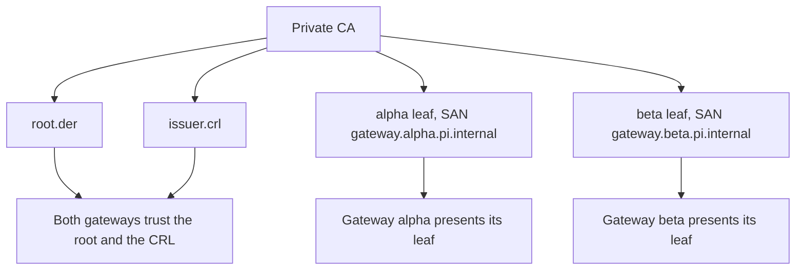

# Connect two machines

Link two gateways, `alpha` and `beta`, over mutual TLS with a private CA. One gateway listens and the other connects.



You need OpenSSL 3 or later, [Nix](https://nixos.org/), and a clock that is correct on both machines.

## Which side listens

The listener binds an address and port. Open that TCP port to the connecting machine, for example 7443. The connector dials it and retries on failure. Identity comes from the certificate, not the address, so you can also forward the port over SSH. Run `ssh -N -L 127.0.0.1:7443:127.0.0.1:7443 listener-host` on the connector's machine and set the connector's address to `127.0.0.1:7443`. TLS still runs inside the tunnel.

## 1. Build the gateway

```sh
cd packages/pi-comms/gateway
nix develop
cargo build --locked --release
```

The binary is `target/release/pi-gateway`.

## 2. Create a private CA

Pick a private working directory. Keep the socket paths short, since they must stay under 100 bytes. Keep `ca/ca.key` off the gateway machines.

```sh
W=$HOME/pi-comms-pki
mkdir -m 700 "$W" && cd "$W"
mkdir ca && cd ca && touch index.txt && echo 01 > crlnumber
cat > ca.cnf <<'CNF'
[ca]
default_ca = CA_default
[CA_default]
dir = .
database = ./index.txt
crlnumber = ./crlnumber
default_md = sha256
default_crl_days = 30
crl_extensions = crl_ext
[v3_ca]
basicConstraints = critical,CA:true
keyUsage = critical,keyCertSign,cRLSign
subjectKeyIdentifier = hash
[crl_ext]
authorityKeyIdentifier = keyid:always
CNF
openssl genpkey -algorithm EC -pkeyopt ec_paramgen_curve:P-256 -out ca.key
openssl req -x509 -new -key ca.key -sha256 -days 365 -subj "/CN=pi-comms private CA" \
  -config ca.cnf -extensions v3_ca -out ca.pem
```

## 3. Issue one leaf per gateway

Each leaf has exactly one SAN, `gateway.<machineId>.pi.internal`, with the same `machineId` as in the gateway config.

```sh
cd "$W/ca"
for m in alpha beta; do
  openssl genpkey -algorithm EC -pkeyopt ec_paramgen_curve:P-256 -out $m.key
  openssl req -new -key $m.key -subj "/CN=gateway.$m.pi.internal" -out $m.csr
  printf 'basicConstraints=critical,CA:false\nkeyUsage=critical,digitalSignature\nextendedKeyUsage=serverAuth,clientAuth\nsubjectAltName=DNS:gateway.%s.pi.internal\nauthorityKeyIdentifier=keyid\nsubjectKeyIdentifier=hash\n' $m > $m.ext
  openssl x509 -req -in $m.csr -CA ca.pem -CAkey ca.key -CAcreateserial -days 90 -sha256 -extfile $m.ext -out $m.pem
done
```

## 4. Issue a CRL

Gateways require a current, complete CRL from the CA, even when nothing is revoked.

```sh
cd "$W/ca"
openssl ca -config ca.cnf -keyfile ca.key -cert ca.pem -gencrl -out ca.crl.pem
```

The CRL expires after 30 days. Run the command again before then and restart the gateways.

## 5. Convert to DER and lock down

```sh
cd "$W"
mkdir creds && chmod 700 creds
openssl x509 -in ca/ca.pem -outform DER -out creds/root.der
openssl crl -in ca/ca.crl.pem -outform DER -out creds/issuer.crl
for m in alpha beta; do
  openssl x509 -in ca/$m.pem -outform DER -out creds/$m.der
  openssl pkey -in ca/$m.key -outform DER -out creds/$m-key.der
done
chmod 600 creds/*
```

Copy `root.der`, `issuer.crl`, and that machine's `<m>.der` and `<m>-key.der` into a `0700` directory on each machine. Create a `0700` `run/` directory beside it for the Unix socket.

## 6. Write the gateway configs

Both configs carry the full `remote` object. This is alpha, the listener. Replace `/home/me/pi-comms` with your directory.

```json
{
  "machineId": "alpha",
  "socketPath": "/home/me/pi-comms/run/alpha.sock",
  "scopeIds": ["team"],
  "policies": [
    { "machineId": "alpha", "scopeId": "team", "permissions": ["discover", "read", "push", "interest"] },
    { "machineId": "beta", "scopeId": "team", "permissions": ["discover", "push"] },
    { "machineId": "beta", "scopeId": "team", "direction": "incoming", "permissions": ["discover", "read", "push", "interest"] }
  ],
  "remote": {
    "machineId": "beta",
    "endpoint": { "mode": "listen", "address": "0.0.0.0:7443" },
    "rootCertificates": ["/home/me/pi-comms/creds/root.der"],
    "certificateChain": ["/home/me/pi-comms/creds/alpha.der"],
    "privateKey": "/home/me/pi-comms/creds/alpha-key.der",
    "crls": ["/home/me/pi-comms/creds/issuer.crl"],
    "revocationState": "/home/me/pi-comms/creds/alpha-floors.json"
  }
}
```

For beta, the connector, swap the machine names. Set `endpoint` to `{ "mode": "connect", "address": "ALPHA_IP:7443" }`, and change the certificate, key and floor paths to `beta`. A `direction` of `outgoing` (the default) covers your local sessions acting on that machine. `incoming` covers that machine acting on yours. See the [gateway reference](../gateway/README.md) for every field.

## 7. Initialise the revocation floor

Run once per gateway, with a private directory. It never overwrites existing state.

```sh
./target/release/pi-gateway --initialize-revocation-floor /home/me/pi-comms/creds/alpha-floors.json
```

## 8. Start the listener, then the connector

```sh
./target/release/pi-gateway --config /home/me/pi-comms/alpha.json
./target/release/pi-gateway --config /home/me/pi-comms/beta.json
```

## 9. Check the ready line

Each gateway prints one line on stdout once it is bound:

```json
{"event":"ready","machineId":"alpha","socketPath":"/home/me/pi-comms/run/alpha.sock"}
```

`ready` does not announce the link. To confirm it, run `lsof -nP -iTCP:7443` and look for an `ESTABLISHED` connection. The connector retries up to six times per minute. If it gives up, it writes `remote_unavailable` to stderr.

## 10. Point each Pi at its socket

In each machine's `session-communication.json`, set `socketPath` to the local gateway's socket and `machineId` to match. Add `policies` for the remote machine, or sessions cannot discover or message it. Reload Pi, then run `/session-communication status`. The gateway's grants and the Pi policies must both allow an action.
