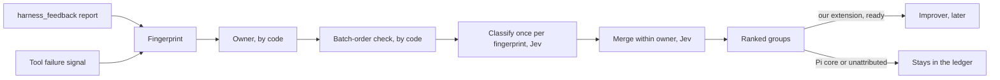

# Design

pi-feedback lets agents report friction with the harness they run in, collects the tool failures that back those reports up, and turns both into a ranked queue of problems in our extensions. This page records the design before any code exists. Each decision names the evidence behind it.

## Background

- OpenCode runs an internal `harness_feedback` tool. Agents call it when they hit a snag, even one they worked around, and another agent improves the harness from the reports ([Dax Raad, 23 Nov 2026](https://bsky.app/profile/thdxr.com)). Models usually work around small problems, so nobody fixes them unless the agent reports them.
- Lauren Tan (poteto) supplies the operating rules:
  - Fix at the strongest layer that works: architecture, then types, then a lint whose error names the fix, then tests, and prose last ([`/correct`](https://github.com/cursor/plugins/blob/main/pstack/skills/correct/SKILL.md)).
  - A mistake becomes a class once it happens twice.
  - "If a script can do it deterministically, use the script. Agents are useful for the fuzzy parts" ([Loops You Can Trust](https://x.com/i/article/2069824386283319343)).
  - A queue is for analysis: findings pile up so related ones can be fixed by one change, instead of one worker per report.
  - Every stage can stop the line.
- TypeSafe's guidance for Jev: keep control flow in code, ask narrow atomic questions, combine the answers in code, set thresholds from labelled data, and pin a model version once thresholds are tuned ([How to build with TypeSafe](https://docs.typesafe.ai/concepts/how-to-build-with-system-one)).

## Scope

| In scope | Out of scope |
| --- | --- |
| Problems in this repository's extensions, which an improver fixes | Fixing Pi core. Pi core problems are recorded and reported, never fixed or forwarded |
| One append-only ledger per machine, read over SSH | Any sync machinery, hidden Git branches or shared stores |
| Deterministic code for every step it can decide | Skills, slash commands such as `/feedback`, and human triage |
| Jev for the judgments code cannot make | Upstream issue drafts |
| Sending ready groups to an improver session | Building the improver, which waits for evidence that the queue is worth it |

## Pipeline

Every stage can stop a record: an outside service, an agent mistake or an uncertain answer ends its path before it reaches the queue.

### 1. Inputs

**The `harness_feedback` tool.** The agent calls it when a tool, instruction, skill or extension gets in its way, including when it found a workaround. Parameters:

| Field | Type | Notes |
| --- | --- | --- |
| `kind` | `tool_error`, `confusing_instruction`, `missing_capability`, `unexpected_behavior`, `workaround` | |
| `component` | string | The tool, extension, skill or prompt section involved |
| `summary` | string, one line | |
| `expected` | string | |
| `actual` | string, required | A concrete observation, so the report can be checked |
| `workaround` | string, optional | What the agent did instead; often shows the fix |
| `impact` | `blocked` or `slowed` | Used for ranking |

The tool does not ask for a guess at the fix layer, which keeps its declaration short. Its prompt guideline names it and says not to use it for bugs in the user's project. Each session may file at most five reports, and a repeat of one already filed in the session is ignored.

**Passive signals.** A `tool_execution_end` handler records each tool result with `isError: true`. Signals never enter the queue alone. They count as evidence for a group and as its sessions, and they find problems no agent reported.

**Context attached by code.** Session ID, model, Pi version, the extension's build (Git SHA when available), the tool's `sourceInfo`, and the last few failing calls of the session. No transcript, file contents or tool results beyond the error text.

**Session note.** Each report also goes into the session with `pi.appendEntry`, shown by an entry renderer, so you can see that something was filed. It does not enter the model's context.

### 2. Fingerprint (code)

- Signals: tool name plus the first part of the error text, with paths, IDs, hashes and numbers removed.
- Reports: `component` plus `kind`.

A fingerprint is a cheap guess that two records are the same problem. It decides which records Jev compares and caches answers, and it is never the final word on grouping.

### 3. Owner (code)

Jev does not decide ownership. Code does:

- A tool's owner comes from `pi.getAllTools()` `sourceInfo`: `source: "builtin"` means Pi, anything else is the extension that registered it. Pi's documentation calls `sourceInfo` the canonical provenance field.
- A path's owner comes from known prefixes: the Claude SDK's scratch directories belong to pi-claude, and `~/.pi/agent/sessions` belongs to Pi.
- A report's owner comes from its `component` when it names a known tool, extension or skill.
- Anything else is `unattributed`.

### 4. Batch-order check (code)

Pi runs the tool calls of one assistant message in parallel. If a failed call reads a path that a sibling call in the same message creates, the cause is the agent's ordering, not the harness. Code compares the failing path with the arguments of sibling calls and labels the record `parallel-batch` without asking Jev.

### 5. Classify (Jev, once per fingerprint)

| Question | Type | Use |
| --- | --- | --- |
| Does the error involve a path, directory name or length limit the harness created? | Noul | Harness evidence for builtin tools such as `bash` and `read` |
| Did the path exist when the call ran? | Noul | Separates a harness-made path from an agent mistake about it; not yet tested |
| Did an outside service cause the error (404, timeout, rate limit, remote API)? | Noul | Ends the record's path |

A rejected or undeclared tool call is detected by code from the pi-claude reason, so it needs no question. Reports, which agents write in their own words, get the same questions about `actual`.

Questions and thresholds live in one file. Requests pin `jev-1.14.0` rather than `jev-latest`, because the alias can move and Pi's result does not say which version answered.

### 6. Merge (Jev, within one owner)

When a fingerprint first appears, Jev compares its example with the example of each open group that has the same owner: "Did `a` and `b` fail for the same underlying reason, even if their wording, tool or file differ?" It merges at 0.6 or above. When a fingerprint's normalized text is too short to say much, such as codemode's `Script failed … Output:`, each record is compared with its group's example, so a vague fingerprint can be split.

Comparing within one owner keeps a report about our extension out of a Pi core group, and keeps the comparisons few.

### 7. Queue (code)

A group is **ready** when all of these hold:

- its owner is one of this repository's extensions,
- it has records from at least two sessions (poteto's "twice"),
- no record in it is labelled `parallel-batch` or outside service, unless other records carry it.

Ready groups rank by sessions × records, doubled when any report says `blocked`.

### 8. Resolve and reopen (code)

A resolve event names the group, the fix commit and the layer it changed (architecture, types, lint, test or docs). A new record in the group from a build that contains the fix commit reopens it. That measures whether a fix held instead of trusting it. When a build cannot be identified, a record dated after the fix's release reopens the group.

## Pi core

Pi core is out of scope for fixes, so a false Pi core label wastes attention and can never be corrected by a fix. A group is labelled Pi core only when every check passes:

- the tool's `sourceInfo` is builtin, or the path is one Pi owns,
- for builtin tools, Jev says the harness created the path (≥ 0.7) and the path existed,
- no outside service failed (< 0.3),
- the batch-order check passed,
- records come from at least two sessions.

Anything less is `unattributed`. Pi core groups stay in the ledger and are never forwarded. A regression test fails if any labelled non-Pi-core record comes out labelled Pi core.

## Ledger

- One append-only JSONL file per machine: `~/.pi/agent/harness-feedback/ledger.jsonl`, directory mode 0700, file mode 0600.
- Events: `report`, `signal`, `verdict` (cached Jev answers by fingerprint), `same_cause` (cached merge answers by fingerprint pair), `resolve` and `reopen`.
- The ledger stores facts. Groups are derived from it on read, so ledgers from several machines combine by concatenation: copy them over SSH and read them together. Nothing syncs.
- A small read-only script prints the ranked queue from one or more ledger files. Resolving appends one line with the same script. Neither is exposed to the model.

## Privacy

- Known secret patterns are redacted before anything is written or sent.
- Jev classification sends the redacted call input and error text, capped in length, to TypeSafe. Nothing else leaves the machine.
- The ledger never enters the repository. This repository is public, so test fixtures are synthetic records written for the tests, not session data.

## Simulation

The design was tested on about two weeks of local sessions (398 sessions, 12–24 Nov 2026) before any code was written.

- **Count thresholds barely filter.** Grouping 75 non-`bash` tool errors by fingerprint gave 11 groups. Requiring two reports from two sessions kept 7, and three from three kept 6. What separates real problems from noise is the cause, so classification does the filtering and the count only decides readiness.
- **Fingerprints both split and merge wrongly.** Two wordings of one pi-claude rejection formed two groups, and one codemode fingerprint mixed four different causes.
- **Jev classification** on 118 hand-labelled errors (47 caused by the harness), asked twice and once with option order reversed:
  - "Harness-created path ≥ 0.7, or a rejected tool call": precision 0.85, recall 0.98. All five false positives from paths were `parallel-batch` reads, which is why the batch-order check and the path-existed question exist.
  - Jev's own owner choice labelled 16 rows Pi core, of which 1 was; with the code-decided owner and the checks above, 0 false Pi core labels. One true Pi core row is too few to prove much.
  - Repeated yes/no answers differed by 0.009 on average and 0.09 at most.
  - Dropped questions: "did the harness write the error" (0.60 even when it did not cause it), "could the agent have avoided it", "what did the agent do next" (12 of 118 answers changed with option order), Jev's owner choice, and "would one fix prevent both".
- **Jev merging** on 103 pairs: precision 1.00 and recall 0.90 at 0.5, 1.00 and 0.77 at 0.7. The highest score for an unrelated pair was 0.43, so 0.6 leaves a margin. It merged both pi-claude wordings (0.97) and split the mixed codemode fingerprint (0.04–0.31).
- **Limits.** The labels were written and the questions tuned on the same rows, so these numbers are optimistic. The simulation saw only recorded errors, never a `harness_feedback` report, so the report path needs its own test once reports exist.

The simulation found [#287](https://github.com/mich-murphy/pi-extensions/issues/287) and [#288](https://github.com/mich-murphy/pi-extensions/issues/288).

## Pi limitations

- `classify()` accepts only string `instructions` and criteria. TypeSafe's API also takes objects, which its documentation recommends for separating guidance from data.
- `classify()` returns the requested model ID, not the version that answered.
- Session directory names start with `--`, which breaks `ls` and `find` without `--`.

These are recorded, not worked around in Pi.

## Improver

Not part of the first version. When the queue shows a real need, a long-running improver session receives ready groups through pi-peers and works in stages that can each stop the line: reproduce with a failing test or the matching `verify-pi-*` run, fix at the strongest layer, and open a draft pull request with `gh stack`. It never merges. pi-peers' `peers_send` is `model-only`, so another extension cannot call it with `ctx.executeTool()`; forwarding needs a programmatic send from pi-peers first. A durable host such as pi-durable comes after that.

## Delivery

One `gh stack`, one pull request per slice:

1. This design.
2. Ledger, fingerprint and the read-only queue script, with synthetic fixtures and property tests.
3. `harness_feedback`, passive signals, attached context and the session note.
4. Owner and batch-order rules, with the Pi core regression test.
5. Jev classification and merging, with questions and thresholds in one file.
6. A scripted end-to-end test that drives the tool through Pi's RPC mode in an isolated agent directory, with an offline model and a stubbed classifier, so it runs in CI without provider calls. A test is used instead of a `verify-pi-*` skill because every step can be checked deterministically.
