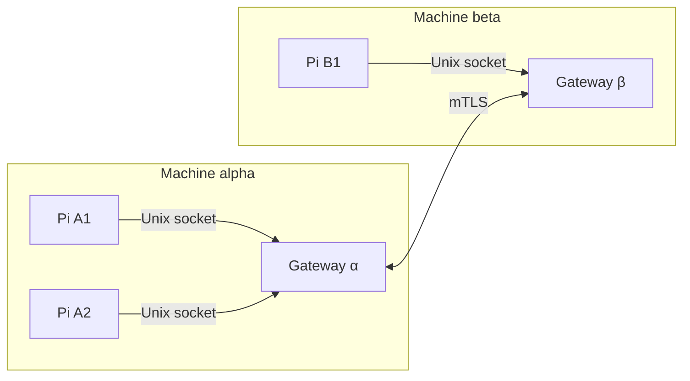

# pi-peers

Lets live Pi sessions send each other messages, on one machine or across machines.

pi-peers does not export transcripts, transfer files, apply patches or run tasks on a peer. Messages are authored by the model or user. Loading an unconfigured extension is inert. After reviewed setup, participating Pi sessions start a detached shared gateway on demand. Session inboxes are volatile; setup choices and credential/floor state remain on disk.



Every session connects to its machine's gateway, including two sessions on the same machine.

Same-machine grants apply across projects on the OS account, not just within a repository. Files and whole transcripts are not automatically shared. Authorized new messages can wake a model and incur provider usage. Peer messages are untrusted content.

## Install

Install the extension:

```sh
pi install git:github.com/mich-murphy/pi-extensions
```

To [load only some extensions](../../README.md#install), see the root README.

## Set up

Type `/peers` in the terminal UI to open the **Peers** menu. Its rows are
Status, Setup, Doctor, Reconnect and Reset, and each shows its current value
(for example `Connected`, `Not set up` or `Activation pending`). Typing `/peers`
followed by a space lists every action, and `/peers <action>` still runs one directly.

Choose **Setup** to open the `Peers › Setup` form. Nothing changes until you
choose Apply. Each row shows its current or default value; press Enter to edit it
in place:

| Row | Default | Notes |
| --- | --- | --- |
| Mode | `Local only` | Switch to `One remote peer` to show the remote rows. |
| Machine | Inferred from this host | Lowercase name for this machine. |
| Scope | `local` | Group of sessions that can see each other. |
| Label | The machine name | Name other sessions see. |
| Permissions | e.g. `4 of 4 on` | Opens a toggle list. |
| Socket | Default path | Shown only when the default path is too long. |
| Remote rows | | Trust, peer machine, connection and address; see [Connect two machines](docs/remote-setup.md). |
| Review details | | The full plan, including technical details. |
| Apply | `Ready`, `Missing: <field>`, `Invalid: <check>` or `Blocked: <reason>` | Runs only when Ready. |

Invalid values show an error on the row and keep the form open. Esc always goes
back one level, and Esc on the Peers menu closes it without changes. Esc on a
result screen returns to the Peers menu. In an RPC client, cancelling a dialog or
leaving it unanswered for 120 seconds also goes back, and every list below the
menu offers `Back`.

Apply shows `Peers › Setup › Applying`, with a row per step (`✓` done, `…`
running, `·` waiting). Esc hides this view while the work continues. When it
finishes, `Peers › Setup › Result` says `✓ Peers set up — connected as <machine>`
or `✗ Setup failed: <reason>` with one fix on the `Next:` line, then lists the machine, scope, permissions,
config file, gateway, remote link and the next step. The same summary is kept in
the session transcript, not sent to the model.

Once peers is set up, the Setup row reads `Manage`. Choosing it opens
`Peers › Setup` filled in from the saved configuration:

| Row | Notes |
| --- | --- |
| Machine, Scope, Label, Permissions | The saved values, edited as in the fresh form. When a pair exists, Machine and Scope are read-only (the pair's certificates name this machine and the paired computer uses this scope), and Permissions also changes what the paired computer may do with this Pi. |
| Review details | What Apply will save and restart. |
| Apply | `No changes` until you edit a row, then `Ready`, `Invalid: <check>` or `Blocked: <reason>`. Settings edited by hand read `Blocked: settings were edited by hand — change pi-peers.json by hand or Reset`. Apply saves only setup-owned files, restarts a running shared gateway once (the row says so) and reconnects this Pi while it is idle. |
| Keep and reconnect | Reconnects with the saved settings; nothing is written. |
| Activate saved configuration | Opens `Peers › Setup › Activate`: restarts the gateway once so it uses the saved settings. |
| Add one remote peer | Local-only setups: opens `Peers › Setup › Add peer` with the remote rows. |
| Pairing rows | Paired setups instead show View public exchange instructions, Import public bundle, Issuer actions (the pair's creator) or Request renewal instructions (the joiner), and Re-pair with new root. Each opens its own screen with one consent row. |

If the installed gateway needs repair, Setup reads `Repair needed` and opens the
repair screen. An interrupted setup, a configuration written by hand
(`Managed outside setup`) or unreadable setup files open a read-only report
that points to Doctor and Reset.

Choose **Reset** to turn peers off for this agent directory. The review lists
what changes and what is kept; nothing happens until you choose `Turn off peers`.
When there is nothing to turn off, Reset reads `Nothing to reset` and shows
`Nothing to reset: peers is not set up for this Pi profile. No changes made.`

Every action shows its progress and result under its own breadcrumb:

| Action | Progress | Result |
| --- | --- | --- |
| Setup Apply | `Peers › Setup › Applying` | `Peers › Setup › Result` |
| Reconnect | `Peers › Reconnect › Reconnecting` | `Peers › Reconnect › Result` |
| Reset | `Peers › Reset › Turning off` | `Peers › Reset › Result` |

A result's first line starts with `✓` (done), `!` (settings saved but not active
yet) or `✗` (failed), followed by the facts, a `Next:` step and any technical
details. While an action runs, Setup reads `Applying…`, Reconnect and Reset read
`Busy`, and `/peers setup`, `/peers reset` and `/peers reconnect` refuse with
`Peers is busy with another action. Try again when it finishes. No changes made.`

The footer always shows how this session is doing while peers is set up,
including when it is connected:

| Footer | Meaning |
| --- | --- |
| `peers ⋯ setting up` | Apply is running. |
| `peers ✓` | This session is connected and its inbox is empty. |
| `peers ● 2` | Connected, with 2 unread peer messages. The agent is woken to read them. |
| `peers ✓ waiting…` | `peers_take` is waiting for a message. |
| `peers ✓ ! dev-01 down` | Connected locally, but the link to `dev-01` is down; the gateway keeps retrying. Sends to that machine fail fast with `link_down`. |
| `peers ! activation pending` | Settings are saved but the gateway hasn't picked them up. Open Setup to activate them. |
| `peers ✕ offline` | The gateway can't be reached. Run `/peers reconnect`, then `/peers doctor`. |
| `peers ✕ setup failed` | This session couldn't start peers. Run `/peers doctor`. |

The symbol is coloured from the theme (`success`, `accent`, `warning`, `error`) and the word `peers` is dimmed; every problem state also has a word, so colour is never the only signal.

There is no footer when peers is not set up. Print and JSON modes show status
and doctor reports but refuse setup and reset.

## Configure

Pi reads `pi-peers.json` from its agent directory, `~/.pi/agent` by default. If no `pi-peers.json`, `pi-peers/` directory exists but the older `session-communication.json` or `comms/` does, Pi uses that older set as a whole (config, `comms/` directory and `~/.pi/comms` socket root) and never moves, rewrites or deletes it. `/peers doctor` names the set in use and how to migrate. It never reads the project. Without the file the extension stays off. The file must be 32 KiB or smaller, and unknown keys are rejected.

```json
{
  "machineId": "workstation",
  "socketPath": "/home/me/pi-peers/gateway.sock",
  "scopeIds": ["team"],
  "label": "Engineering session",
  "policies": [
    {
      "machineId": "workstation",
      "scopeId": "team",
      "permissions": ["discover", "push"]
    }
  ]
}
```

| Field | Required | Constraint | Purpose |
| --- | --- | --- | --- |
| `machineId` | yes | `^[a-z][a-z0-9-]{0,31}$` | Name of this machine. |
| `socketPath` | yes | Absolute, 100 bytes or fewer (the gateway's limit), no control characters | The gateway's Unix socket. |
| `scopeIds` | yes | 1–4 unique values matching `^[A-Za-z0-9_-]{1,64}$` | Groups this session joins. |
| `label` | yes | 1–128 bytes, no control or bidirectional characters, some visible text | Display name for peers. Keep paths and transcript text out. |
| `shareBranch` | no | `true` or `false` (default) | Adds the git branch checked out at connect to the label peers see. |
| `maxWaitSeconds` | no | Integer 1–300 (default 300) | Longest `peers_take` wait this session allows. |
| `policies` | yes | 256 or fewer entries | Which machines may do what in which scope. |
| `policies[].machineId` | yes | Same pattern as `machineId` | Machine the grant applies to. |
| `policies[].scopeId` | yes | Scope pattern | Scope the grant applies to. |
| `policies[].permissions` | yes | Any of `discover`, `push` | Allowed actions. The retired `read` and `interest` are accepted and ignored, so older files still load; the next Apply writes them without. |

## First call

Start two Pi sessions on the same machine. Both use the same config and gateway. In one, ask the model: "Call `peers_list`." The other session appears with a handle such as `s-4f2a` and its label. Then ask the model to send it a message with `peers_send`. The receiving session is woken and reads it with `peers_take`.

## Tools

| Tool | Parameters | Purpose |
| --- | --- | --- |
| `peers_list` | `scope?` | List sessions you can message, each with a handle and its label. |
| `peers_send` | `to` (handle), `kind`, `content`, `format?` (default `markdown`), `replyTo?` (message id), `retryOf?` (message id), `status?`, `scope?` | Send a request, reply or update to one session. |
| `peers_take` | `limit?` (1–8, default 4), `waitSeconds?` (0–300, default 0) | Move messages from your inbox into the conversation, waiting for the first one when asked. |

`peers_send` and `peers_take` are declared to the model only (`model-only`). `peers_list` also returns `structuredContent` for scripts.

### Use from codemode

Scripts can call only `peers_list`, which resolves to `{ ok, peers: [{ handle, label, self, restarted }] }` or `{ ok: false, code, note }`. `peers_send` and `peers_take` are not callable from scripts: a script that fails after a send cannot tell whether to resend, and a take removes messages that a failed script would lose. Call them directly instead.

`format` is `text`, `markdown`, `git-diff` or `git-format-patch`. All formats are descriptive; nothing is applied or fetched.

`waitSeconds` makes an empty `peers_take` wait for the first message, up to `maxWaitSeconds`. It returns as soon as one arrives, and says so when none arrived in time. Only one take can wait at a time. A wait ends early, as an error, when Escape cancels it, Peers disconnects (nothing can arrive) or the session stops.

### Handles

A handle names one Pi session (machine and session), not one runtime. It is `s-` and the first four hex digits of the SHA-256 of `machineId`, a newline and `sessionId`; if that prefix is already taken by another session in this runtime, it grows to 6, 8 or more digits. A handle is never reused for another session, and handles are local to this session: a handle quoted by a peer means nothing here. A second live runtime of the same session is listed as `s-4f2a/2`.

A send goes to the exact runtime last listed for the handle; it is never redirected to another runtime. A runtime that is still listed keeps its handle. A new runtime of a session takes the handle of a runtime that is no longer listed, marked `restarted` because that runtime's unread inbox and receipts are gone; otherwise it gets the next free `/n`. Being listed does not mean a session is active.

`replyTo` takes the id of a message you took with `peers_take`; the adapter remembers the sender and scope of the last 256 taken messages. A reply never goes to a newer runtime of the sender.

Results show message ids as short session-local aliases such as `m-3f2a`: the first four hex digits of the 32-hex id, growing by two while that prefix names another remembered id. `replyTo` and `retryOf` accept the alias or the full id. An alias is never reassigned, and the adapter still checks the id against the taken messages or unsure sends it remembers.

### Labels

Labels are claims made by the other session and are not verified. Your own session is marked by comparing runtime identities, never label text. Each session registers a label made of, in order: the configured `label`, the session name, the repository folder name, `derived from s-xxxx` for a forked session, and `branch X at connect` when `shareBranch` is true. Control and bidirectional characters are removed. Parts are dropped from the end to fit 128 bytes; the configured label is cut only as a last resort. The session name and branch are as they were at connect and can go stale.

## Commands

| Command | Behavior |
| --- | --- |
| `/peers` | Opens the Peers menu in the terminal UI; prints status elsewhere. |
| `/peers status` | Plain status for this session: machine, scopes, inbox, one `Link to <machine>` row per remote link (`Up`, `Reconnecting` or `Down`, with since and next try) and the next step. Exact identifiers are under Technical details. It does not check remote credentials; `/peers doctor` does. |
| `/peers setup` | Opens the Peers menu with Setup open; Esc returns to the menu. For an existing setup, the form is filled in from the saved configuration, with repair, pairing, adding a peer or activating saved settings where needed. |
| `/peers doctor` | Read-only checks of the config file, gateway, permissions, remote credentials and pairing expiry, each with what to do next, ending with `Live: <status headline>`. When this session knows the remote link state, the remote row adds `Live link: <machine> <state>`. Never starts or connects to the gateway or writes files. |
| `/peers reconnect` | Retries the connection without losing this session's inbox or state, and never resends uncertain messages. |
| `/peers reset` | Opens the Peers menu with Reset open; `Turn off peers` disables setup-owned participation. Keeps the executable, keys and revocation state; never stops the shared gateway. |

## Limits

| Limit | Value |
| --- | --- |
| Frame size | 32 KiB |
| Message `content` | 24,576 characters, and 24 KiB of authored data per frame |
| `refs` per message | 8 |
| Inbox | 64 messages, 1 MiB |
| Receipts kept | 1,024, for at least 10 minutes |
| Relations | 256 |
| Requesting peers per work item | 8 |
| Sessions per gateway | 30 |
| Send attempts | 3 within 15 seconds |
| Remote link retries | 6 within 60 seconds, then a probe every 30 seconds to 5 minutes (jittered), forever |

## Delivery receipts

- `admitted`: the receiving session's inbox holds the message. It does not mean read, accepted or done.
- `not_admitted`: the attempt is known not to have been admitted. Code `link_down` means the link to the recipient's machine is down: the session may still exist, and sending again later cannot duplicate the message. `peers_list` marks such peers `(link down)`. Code `no_route` means the runtime is not reachable now; it does not mean its messages were discarded. Code `expired` means the send ran out of time on the way and was dropped before any inbox; sending again cannot duplicate it.
- `unknown`: it may have been admitted. The adapter retries with the same `message.id`; do not resend the work as a new message. To try again later, repeat the call unchanged with `retryOf` set to its id. The adapter resends the stored message, with the same id and bytes, to the exact runtime it first went to, and the receiver answers a duplicate with its original receipt. `retryOf` is refused for a message that was delivered or not delivered, for a changed `to`, `kind` or `content`, and after 8 minutes, because receivers keep receipts for 10.

See [design](docs/design.md#receipts-and-idempotency).

## Safety and setup details

Setup asks before every change. Esc, Cancel, an invalid RPC answer or a
120-second unanswered dialog makes no setup writes, downloads or gateway starts.
Print/JSON setup/reset refuse mutation; there is no unattended `--yes` bypass.
Review details discloses that same-machine grants are account-wide, that peer
messages can wake the model at provider cost, and the gateway's acquisition
source and hash.

**Acquisition gate:** this source tree ships one reviewed immutable Nix source pin
(producer revision `7c0bdcc` on `main`, with its NAR hash)
and the reviewed manifest pin of the published
[Pi Gateway v0.2.0](https://github.com/mich-murphy/pi-extensions/releases/tag/pi-gateway-v0.2.0)
native release, built from the same revision. On a supported target (macOS arm64,
Linux arm64 or Linux x64), Apply builds the pinned gateway into a private
dedicated result when a usable system Nix exists. Without usable Nix, or if the
Nix build fails, the same Apply downloads the native archive and authenticates
it against the pinned manifest before installing. On other targets, including
Intel macOS, fresh production Apply reports **Blocked**, without writing
configuration or choosing a project/PATH binary. The macOS native binary is
ad-hoc signed, not Developer ID signed or notarized: `spctl` rejects it, and
browser quarantine or managed-device policy can block it. Setup never clears
quarantine or bypasses Gatekeeper. A previously installed, hash-verified setup
executable can be reused. A local test binary is not a production acquisition
route.

For manual operation on a blocked host:

1. Build from a trusted checkout using `cd packages/pi-peers/gateway && cargo build --locked --release` (`nix develop` provides the toolchain).
2. Create a private persistent socket directory and gateway configuration. It has the Pi fields below without `label`; see the [gateway reference](gateway/README.md#configuration).
3. Start `pi-gateway --config /absolute/path/to/gateway.json` yourself.
4. Write the Pi configuration below and run `/peers reconnect` to activate an absent runtime. Existing custom/external/symlink configurations are preserved; guided setup does not silently adopt or migrate them.

Setup-managed gateways run without launchd/systemd definitions: the first
participating Pi starts the singleton; the last closes it after a bounded grace.
Closing one Pi never kills the shared process. A crash while Pis remain open
triggers bounded reconnect-or-spawn/re-registration episodes, keeping their nonce,
inbox state and never replaying uncertain sends. Exhaustion is
reported; the next explicit reconnect or tool call can start another bounded
episode, not a perpetual background retry.

The socket/managed ownership lock live under canonical home
`.pi/pi-peers/<agent-directory-hash>/s` in private owned directories. Paths must fit
100 UTF-8 bytes. An overlong home requires an explicitly reviewed short persistent
private location, never a silent temporary-path fallback. Intentionally separate
agent profiles have separate gateways; ordinary sessions sharing an agent
directory share one. This is same-account trust across projects, not isolation
from root or other code running as that account.

Managed setup requires the `config-generation-v1` capability. Each connection
attempt sends the expected SHA256 from that attempt's verified setup snapshot;
the gateway admits it only when those are the exact config bytes loaded by its
managed process. A reachable socket alone is not activation proof. Manual clients
without a managed ensure callback retain legacy registration without the field.
There is no unguarded fallback if an older gateway rejects the field or closes.
This fingerprint does **not** attest PKI-content freshness or remote link readiness;
supported pairing updates select new immutable credential-generation paths.

Fresh Apply discloses an already-present shared socket using read-only inspection
(no pre-Apply connect), saves the reviewed configuration, and sends at most one
machine-bound restart request when that prior socket was observed. An uncertain
restart, generation mismatch or failed guarded admission reports **configuration
saved; activation pending/unconfirmed**, not connected. Surviving old sessions may
still use old trust until the old gateway exits. An old instance appearing after
the review snapshot is also blocked by guarded admission, not silently adopted.

`/peers reconnect` and passive recovery only retry guarded admission within the
existing bounded episode (six attempts / sixty seconds); they never send restart
control or replay application requests. To explicitly retire an old instance, use
`/peers setup` → **Activate saved configuration**, review, then
**Restart and activate**. This sends
one separate user-approved restart and reconnects the same Pi runtime: nonce,
inbox and receipts are retained. Incompatible survivors
with narrowed identity/scope/grants remain refused. A cancelled action does
nothing; uncertain control is never automatically replayed.

Reconnect is not a blanket `/reload`: it does not replace an existing runtime's
adapter policy snapshot. Maintenance reloads compatible setup metadata for the
launcher while retaining the Pi's identity/state. Adding remote grants explicitly
reviews replacement of **this** Pi runtime and loss of its inbox and receipts. Other already-open Pis keep their conservative earlier
adapter grants; they do not automatically gain the new remote permissions.

Missing configuration on disk does not prove an old runtime is disabled. Reset
closes this Pi's runtime after disabling owned disk configuration; other running
Pis are not silently replaced. Unknown/custom/symlink configuration or changed
ownership hashes fail closed without overwriting external bytes. Interrupted
Apply/reset reports retained effects; retry reset only for an owned recovery
ledger. The native permanent flock releases on holder EOF/crash and is never
removed as a stale PID file.

If a setup-owned executable disappears (including Nix GC) or its bytes/type change,
`/peers setup` offers an explicit **installation repair**, not an automatic update.
Inspection never executes the broken file: symlinks, FIFOs/devices and oversized
files fail promptly. Cancel does not acquire or write. Reviewed Apply uses a fresh
trusted acquisition route, then the verified new helper's native lock and CAS to
update only installed/executable metadata. Configuration, keys, floors and old
unknown files are retained; existing Pi runtimes keep nonce/state. An interrupted
metadata update has a resumable repair ledger; finish it with setup before reset.
Externally changed adapter/gateway/pairing bytes refuse repair. With no trusted
catalog pin, repair is honestly blocked just like a fresh install; it never falls
back to executing the broken file or choosing a project/PATH binary.

For remote peers, use [guided pairing and maintenance](docs/remote-setup.md).
Native existing-material import preserves a live existing floor and generates a
public renewal request, but does not adopt external issuer custody. Its signer
and update bundle must match the imported runtime's exact pair/offer binding;
arbitrary external-CA renewal is not automated or proven by guided import.
A local connected result does not claim a remote link. Expired/bad remote
credentials degrade the remote side while leaving local communication available.
Unknown sends must never be resent as a new message ID.

## More

- [Connect two machines](docs/remote-setup.md)
- [Gateway reference](gateway/README.md)
- [Design](docs/design.md)
