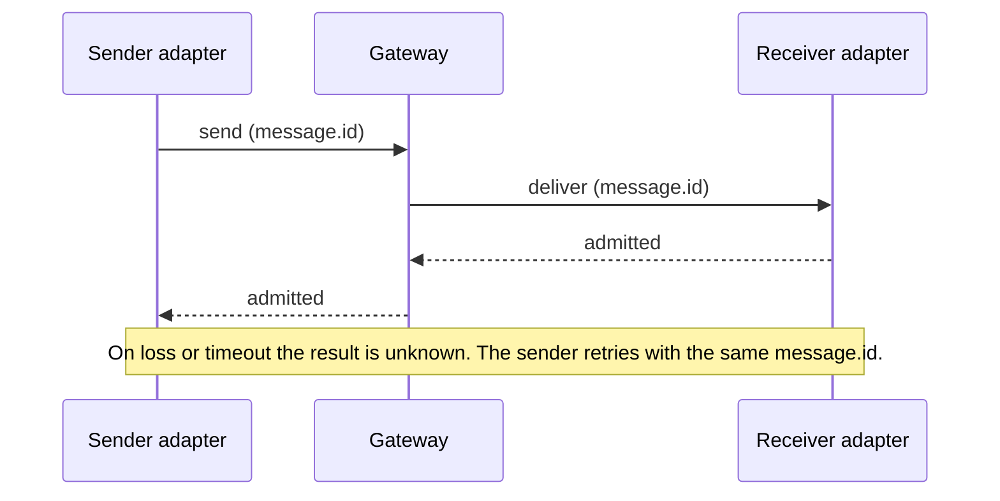

# Design

pi-peers keeps message delivery small and explicit. A gateway only routes. Each Pi session's adapter owns the inbox and receipts, all in memory.

## Receipts and idempotency

`message.id` is the idempotency key. Its namespace is the exact sender, recipient and scope. The adapter creates one id per `peers_send` call and keeps every authored field unchanged across at most three attempts within 15 seconds. Only the attempt id, `rid`, changes.

| Receipt | Meaning |
| --- | --- |
| `admitted` | The receiver's volatile inbox holds the message. Not read, accepted or completed. |
| `not_admitted` | The attempt is known not to have admitted it. |
| `unknown` | It may already be admitted. A later rejection does not erase that doubt. |

Protocol v2 receipts carry only what their reader cannot derive: `messageId`, the outcome and, for `admitted`, `correlation` and `durable`. Sender, recipient and scope are known from the retained request, which each hop matches by `rid` before it compares `messageId`. The receiver's dedupe key (sender, recipient, scope, `message.id`) and fingerprint are unchanged, so a repeat still returns the original receipt and changed content still gets `id_conflict`. `durable` is set by the receiving adapter (always `false` until the inbox is durable); the sending adapter stores it per message and never shows it in send results.

## Upgrading from wire v1

Wire v2 refuses every v1 frame with one exception: a local `gateway.restart` request may be `"v":1`, and its acknowledgement echoes that version. `--request-restart` always sends v1, so the same command stops a running 0.2.0 gateway (which speaks only v1) and a 0.3.0 one. The restart is still sent once and never replayed; an uncertain outcome stays uncertain. An adapter whose register is closed unanswered, or answered in a frame it cannot decode, reports "The running gateway is an older version" and points to Setup, which restarts it once. The adapter never restarts the gateway itself.

## Time budgets

`send` and `deliver` carry `budgetMs`, the time left in the sender's 15 s budget, in the frame header and not in the message, so the fingerprint and idempotency are unchanged. Each gateway hop waits min(`budgetMs`, 15 s) less a 250 ms reserve and forwards that wait less another 250 ms, so the next hop always gives up first. A hop that cannot forward a positive budget answers `not_admitted` code `expired` without forwarding: the message was not delivered and sending again cannot duplicate it. Expiries are logged as the coalesced `expired` event, timeouts as `forward_timeout`.

A repeat with the same id and content returns the original receipt without a second enqueue or wake, even when the inbox is full. The same id with different content returns `id_conflict`. A receipt is kept for at least 10 minutes from first admission, and for as long as its payload is still in the inbox. After it expires, a late duplicate can be admitted again, so this is not permanent exactly-once delivery.

## PeerRef

A `PeerRef` is `machineId`, Pi's `sessionId` and a random `runtimeNonce`. The nonce changes whenever Pi reloads, starts a new session, forks or resumes. A send to an old nonce fails instead of reaching the replacement. A gateway reconnect keeps the identity and the in-memory state.

## Handles

Models address peers by handle, not by `PeerRef`. A handle names a session: `s-` and the first four hex digits of sha256 of `machineId` and `sessionId`, lengthened when another session in this runtime already holds that prefix. A handle is never reused for a different session, and it is local to the runtime that assigned it. A second live runtime of one session gets `/2`.

Each handle binds the exact runtime `peers_list` last saw. A send always goes to that `PeerRef`; the adapter never redirects a send to a newer runtime. A runtime that is still listed keeps its handle, whatever order the gateway lists it in. A new runtime takes the first handle of its session whose runtime is no longer listed, and that handle is marked restarted because the old runtime's unread inbox and receipts are gone; otherwise it gets the next free `/n`. `replyTo` takes a message id (or its `m-xxxx` alias) and resolves its sender from the last 256 taken messages; a reply to a restarted sender is refused rather than redirected.

Labels are what each session says about itself. `self` is decided by comparing `PeerRef`s, and no routing or permission depends on label text.

## Inbox, wake and take

Pi has no public way to know when a custom message it queued was actually consumed. Retiring it on `agent_settled` or `hasPendingMessages()` is unsafe: after Escape clears Pi's queue, a message that arrives during the abort stays queued even though both signals say idle. Releasing its charge would undercount. Keeping every unsure message charged would eventually fill the adapter. So message bodies never enter Pi's queue.

- The adapter keeps authored messages in its own bounded inbox.
- A new admission asks for a wake: one notice that counts the waiting messages and names their senders by handle, never the message itself. No notice is sent when the inbox is already empty.
- `peers_take` moves a batch of up to 8 messages into the conversation. It frees their inbox slots but keeps their receipts. A take that empties the inbox clears any pending wake.
- `peers_take` with `waitSeconds` waits for the first admission instead of polling. One waiter at a time; it ends on a message, its timeout, Escape, a disconnect or shutdown.

Wake rules:

- **Idle:** one notice goes out at once through `sendMessage` with `triggerTurn`. At most one notice is outstanding. Only its own `message_end` clears it, not a take, a timeout or settling. A notice that never shows up stays at one and the status reports it as `degraded_unobserved`.
- **Busy:** the adapter never sends. It records one pending wake. At the next `agent_before_settle` the pending wake becomes one notice and the run continues. Several arrivals share one notice.
- **Settled:** pending wake intent is cleared.
- **Compaction:** after a manual compaction succeeds or fails, one deferred check wakes the model if Pi is idle and a wake is pending. There is no polling.

Escape is Pi's own cancel. An aborted run skips `agent_before_settle`, so old messages are not announced again. Abort does not replay anything, restore text, mute peers or cancel remote work. Messages stay in the inbox until a take. Only a new authorized push can wake a later turn. Discovery, control traffic and duplicates never wake anyone.

Admission is not consumption. Replacing the runtime discards the inbox and receipts, and there is no offline mailbox.

Local tools do not wait on gateway recovery. While the gateway is unreachable, `peers_take` still returns already-admitted messages. Local tools never start recovery. After the bounded automatic reconnect episode gives up, the runtime stays disconnected until a remote tool runs its recovery preflight or `/peers reconnect` succeeds, and until then it receives no new deliveries. Discovery and sends keep the guarded recovery preflight and fail closed.

## Remote link

Each gateway keeps a circuit breaker for its remote machine.

- **Closed:** after a lost link or a failed handshake, up to 6 attempts within 60 seconds, backing off from 250 ms. A link that drops right after its handshake counts as a failure too.
- **Open:** when that episode is spent. Sends routed to that machine fail at once with `not_admitted` code `link_down` instead of waiting 15 seconds. One probe is scheduled after 30 s, doubling to 240 s, plus up to a quarter of jitter, so every wait is between 30 s and 5 min. A failed probe reopens it; there is no final state.
- **Half-open:** one probe in flight. Success closes the breaker and the roster is fetched again. A local session registering in a scope the remote serves brings the next probe forward.

Sessions see `up`, `probing` (an attempt is in flight or due within seconds) or `down` (open, with the next probe time). A gateway pushes a `link.state` frame to every registered session: once after registration and then exactly on each change. Every local session gets `link_down` for a machine whose link is down.

On the link, `send` may name a peer by a small number instead of its full `PeerRef`. Each gateway numbers the peers it exports in the order it sends their roster upserts, and the other side numbers them the same way as it imports them. Numbers are never reused, are capped at 1,024 per direction (later peers travel in full) and die with the link: a new link starts with empty tables, and an unassigned number closes the link.

The gateway writes coalesced JSON events to stderr, at most one per kind every 30 s with a `suppressed` count: `link_state`, `forward_timeout`, `expired` and `overloaded`. They carry no payload, path or credential.

## Trust model

- Gateways talk over TLS 1.3 only, with mutual authentication. Session resumption and early data are off.
- Remote links require Tailscale. Gateways speak plain TCP (frame protocol v2) inside the tailnet; WireGuard encrypts and authenticates the path. There are no keys, certificates or TLS.
- Identity and remote permissions come only from the local `tailscaled`, through `tailscale whois --json <ip>`. The remote's machine name is the first label of its tailnet name; a peer cannot choose it. Before any byte is read or sent, the socket's local address must be one of this node's tailnet IPs, and whois must resolve the peer IP to another, unexpired node.
- Remote authorization lives in the tailnet policy file as app capability `github.com/mich-murphy/cap/pi-peers`: a list of `{"scopes": [...], "allow": [...]}` entries. The granted set is the union over entries of scopes × actions, never a union of scopes and actions across entries. Unknown actions are ignored and `"*"` grants nothing.
- The destination enforces. A grant from X to Y says what X's sessions may do to Y's sessions: `discover` (receive Y's roster entries in those scopes), `push` (deliver requests, updates and replies) or `reply`. There is no outgoing policy for remotes, and the adapter does not filter remote roster entries or sends by local policy.
- `reply` admits responses to messages this node sent to that node: a `reply`, or an `update` with `replyTo`, to the exact local sender, from the exact remote recipient, in the same scope, within 600 s of the first send. One reply closes the entry; at most 8 updates. `push` implies `reply`; a `request` is never admitted under `reply`. Refusals use `forbidden`.
- Caps are re-read every 15 s, so a revocation takes effect within about 15-30 s plus netmap propagation.
- Whoever controls the tailnet's coordination server or policy file decides both identity and permissions. Tailnet Lock signs node keys only, not policy.
- Local `policies` govern sessions on the same machine only, and may name only this machine. pi-peers without Tailscale keeps working locally.
- The local socket trusts the same user account, not individual processes.
