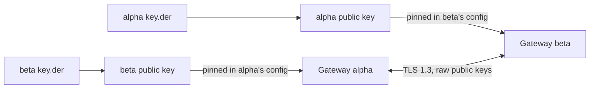

# Connect two machines

Link two gateways, `alpha` and `beta`. One gateway listens and the other connects.

Each gateway has one Ed25519 key. Each pins the other's public key, as SSH pins a
host in `known_hosts`. The link is TLS 1.3 with raw public keys in both directions:
a gateway accepts the peer only when it presents exactly the pinned key. There is
no CA, certificate, CRL, revocation floor or expiry to manage.



The key is identity; the network path only provides reachability. Run the link
inside Tailscale (recommended) or an SSH forward rather than exposing the port to
the internet.

## Guided setup

On each machine, type `/peers`, choose **Setup** and set **Mode** to
`One remote peer`. Setup creates this machine's key, shows its public key to send
to the other machine, and asks for the other machine's public key, its name, which
side listens and the address. It writes the same configuration as the manual
recipe below. `/peers doctor` reports whether the key and configuration are usable;
it does not prove the live link is up.

Public keys are not secret, but confirm the peer's key over a channel you trust
(read it aloud, compare it in person, or send it over an authenticated chat). A
wrong key is the only way to link to the wrong machine.

## Choose the network path

### Tailscale (recommended)

Put both machines on the same tailnet. On the listening machine, bind the gateway
to its tailnet address, never `0.0.0.0`:

```sh
tailscale ip -4   # for example 100.64.0.1
```

Use `100.64.0.1:7443` as the listener's address and as the connector's address.
Restrict the port in the tailnet policy file so only the peer can reach it, for
example:

```json
{
  "grants": [
    { "src": ["beta-host"], "dst": ["alpha-host"], "ip": ["tcp:7443"] }
  ]
}
```

Tailscale encrypts and authenticates the path; the pinned keys still authenticate
the gateways, so a compromised or misrouted tailnet node cannot impersonate either.

### SSH forward

Without Tailscale, let the listener bind loopback (`127.0.0.1:7443`) and forward it
from the connecting machine:

```sh
ssh -N -L 127.0.0.1:7443:127.0.0.1:7443 alpha-host
```

Set the connector's address to `127.0.0.1:7443`. TLS still runs inside the tunnel.
Keep the tunnel running, for example with `autossh` or a user service; the
connector retries on its own while the tunnel is down.

## Manual setup

### 1. Build the gateway

```sh
cd packages/pi-peers/gateway
nix develop
cargo build --locked --release
```

The binary is `target/release/pi-gateway`.

### 2. Generate a key on each machine

Pick an owner-only directory. Keep the socket path under 100 bytes.

```sh
D=$HOME/pi-peers
mkdir -m 700 "$D" "$D/keys" "$D/run"
printf '{"version":1,"privateKey":"%s/keys/gateway.key"}' "$D" > "$D/key.json"
./target/release/pi-gateway key generate --input "$D/key.json"
```

It prints one line, for example:

```json
{"version":1,"operation":"generate","publicKey":"3d4017c3e843895a92b70aa74d1b7ebc9c982ccf2ec4968cc0cd55f12af4660c"}
```

`generate` refuses to replace an existing file, so a key is never overwritten by
accident. The key file is `0600` in a `0700` directory and never leaves the
machine. To print the public key again, run `key show` with the same input file.

Send only the `publicKey` value to the other machine, and confirm it out of band.

### 3. Write the gateway configs

This is alpha, the listener. Replace the paths and the peer's key.

```json
{
  "machineId": "alpha",
  "socketPath": "/home/me/pi-peers/run/alpha.sock",
  "scopeIds": ["team"],
  "policies": [
    { "machineId": "alpha", "scopeId": "team", "permissions": ["discover", "push"] },
    { "machineId": "beta", "scopeId": "team", "permissions": ["discover", "push"] },
    { "machineId": "beta", "scopeId": "team", "direction": "incoming", "permissions": ["discover", "push"] }
  ],
  "remote": {
    "machineId": "beta",
    "endpoint": { "mode": "listen", "address": "100.64.0.1:7443" },
    "privateKey": "/home/me/pi-peers/keys/gateway.key",
    "peerPublicKey": "<beta's 64-character public key>"
  }
}
```

For beta, the connector, swap the machine names, set `endpoint` to
`{ "mode": "connect", "address": "100.64.0.1:7443" }` and pin alpha's public key.
A `direction` of `outgoing` (the default) covers your local sessions acting on that
machine; `incoming` covers that machine acting on yours. See the
[gateway reference](../gateway/README.md) for every field.

The gateway refuses a config that pins its own key (`--diagnose` reports reason
`identity`), because a connection reflected back to itself would otherwise pass.

### 4. Start the listener, then the connector

```sh
./target/release/pi-gateway --config /home/me/pi-peers/alpha.json
./target/release/pi-gateway --config /home/me/pi-peers/beta.json
```

Each gateway prints one `ready` line on stdout once it is bound. A listener adds
`"remoteListenAddress"` with the address it bound; with a configured port of `0`
this is where you read the port the OS chose. A connector never accepts port `0`.

`ready` does not announce the link. The connector retries up to six times per
minute, then probes every 30 seconds to 5 minutes until it connects. Each change
writes a `link_state` event to stderr, and `/peers status` shows a
`Link to <machine>` row.

### 5. Check the configuration

```sh
./target/release/pi-gateway --diagnose /home/me/pi-peers/alpha.json
```

A usable setup reports
`{"state":"configured","trust":"pinned","publicKey":"<this machine's key>"}`.
Compare that key with the one pinned on the other machine. An unusable key file
reports `{"state":"degraded","reason":"private-key"}`; local sessions keep working
while the remote side is closed.

### 6. Point each Pi at its socket

In each machine's `pi-peers.json`, set `socketPath` to the local gateway's socket
and `machineId` to match. Add `policies` for the remote machine, or sessions cannot
discover or message it. Reload Pi, then run `/peers status`. The gateway's grants
and the Pi policies must both allow an action.

## Replace or revoke a key

There is nothing to renew. To replace a key (a lost or exposed machine, or a
routine change), generate a new key file on that machine, send its public key to
the peer, update `peerPublicKey` there and `privateKey` here, and restart both
gateways. The old key stops working as soon as the peer restarts with the new pin.
To cut a machine off entirely, remove `remote` from the other gateway's config and
restart it.

## Upgrading from certificates

Gateway 0.4.0 no longer supports the private CA, CRLs, revocation floors or the
`pair` command. A config whose `remote` still has `rootCertificates`,
`certificateChain`, `crls` or `revocationState` fails to start, and `--diagnose`
reports `{"state":"retired-certificates"}`. Re-link both machines with keys as
above; the old certificate and floor files can then be deleted.
