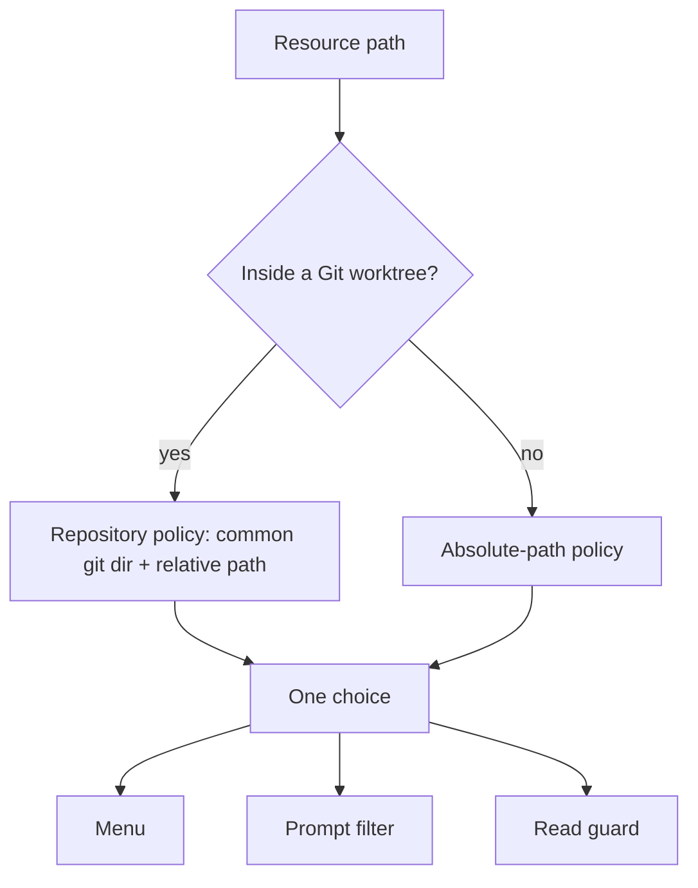
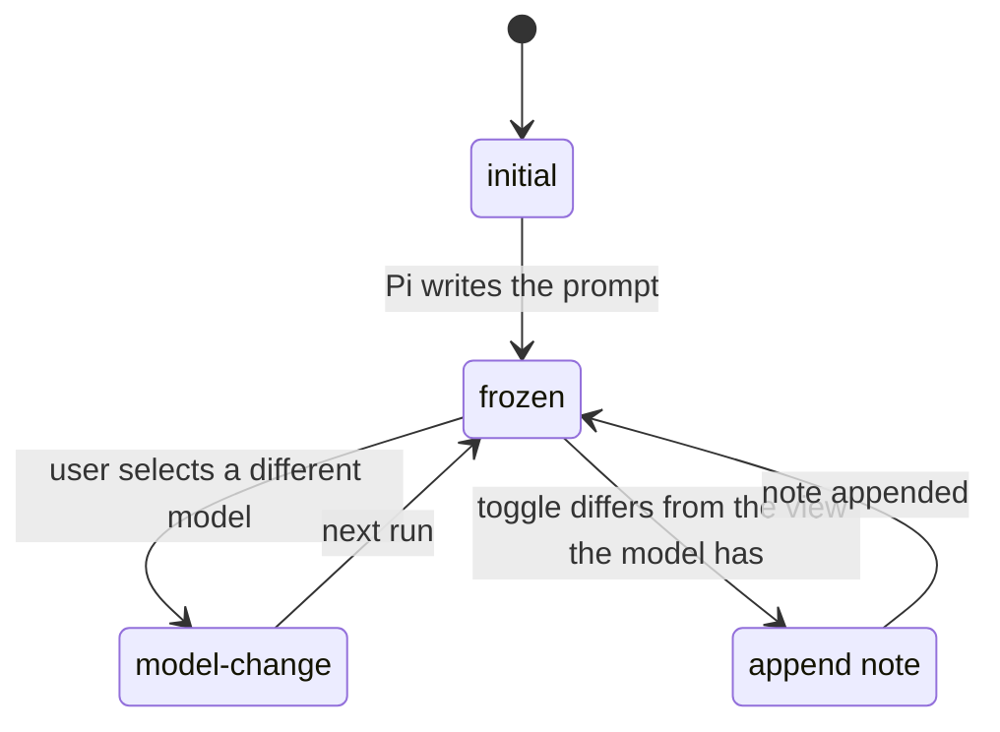

# Design

This page explains how pi-skill-toggle decides what a toggle means and how it keeps toggles from breaking the provider's prompt cache. For everyday use, see the [README](../README.md).

## Policy scope

The menu, the prompt filter and the read guard all ask one resolver for a resource's choice. The resolver keys each path like this:

- Repository identity is the canonical common Git directory, so every linked worktree of a repository shares one choice per relative path. A pruned worktree whose Git folder is missing counts as outside Git.
- Global discovery paths (the agent directory and `~/.agents/skills`) always use absolute paths, even when your configuration lives in Git.
- Absolute paths are normalized without following symlinks.

## What a protection covers

- An instruction protects only its own file. Disabling `AGENTS.md` leaves `web/AGENTS.md` alone.
- A skill protects the directory that holds its `SKILL.md` and everything below it, such as references and scripts. A separately loaded nested skill, or a standalone Markdown skill, follows its own choice instead of the outer skill's.
- The guard also compares on-disk identity, so a symlink or a differently cased name on a case-insensitive file system reaches the same protection.
- `/skill:name` in the current session keeps that loaded skill readable. This never changes saved choices.

## Supplemental skill discovery

Pi already discovers skills in the working directory's `.pi/skills`, ancestor `.agents/skills`, the agent directory and `~/.agents/skills`. The extension adds, from the working directory up to the Git root:

- `.pi/skills` in ancestor directories,
- `.claude/skills` and `.codex/skills` in the working directory and its ancestors.

Outside Git it stays within the working directory. Rules:

- Discovery runs only in a trusted project.
- Native skill names win, including names excluded by settings. Among supplemental copies, the first discovered name wins.
- Malformed skills are skipped. Missing configured packages are not installed to inspect them.

## Subagents follow the parent

Each session registers a policy object in a process-wide registry, `globalThis[Symbol.for("pi-skill-toggle.sessions")]`, keyed by session id. A subagent loads its own copy of the extension, so `globalThis` is the only thing the two share. A session is a subagent when its header records a parent session id; `/new` and `/fork` record a file path and stay main sessions.

The parent answers live, at every tool call and run:

- Reads: the subagent blocks a path exactly when the parent would, including skills you invoked with `/skill:name` in the parent.
- Prompt: a resource the parent knows, by path or for skills by name, is visible when the parent enables or invoked it. Other resources keep the subagent's own state.
- A parent that cannot decide blocks the path. Without a registered parent, the subagent uses its own state.

Registry entries are plain versioned objects of functions, validated on every read. Nested subagents follow the root through their own parent.

## Prompt freezing

Changing a system prompt mid-session invalidates the provider's cache for everything after the change. Some providers, including `pi-claude-sdk`, cannot express a mid-conversation system message and resend a full checkpoint. An appended note costs only its own text. So after the first request the extension keeps the prompt as the model has it and announces toggles in a note.

Each run reads the current branch's transcript to learn which resources the prompt lists, then picks an epoch:

- `initial`: the transcript has no system message, so your current toggles shape the prompt.
- `model-change`: since the latest response, you selected another model than the one that response ran under. The new model's cache is cold, so the prompt takes your current toggles at no extra cost. Virtual-model routing, a provider reporting a different id, and Pi re-recording an unchanged selection all stay `frozen`.
- `frozen`: every other run. Each toggle resource keeps the status it has in the prompt.

The model's view is the prompt's resources, overridden by the latest `pi-skill-toggle` note. When your choice differs from that view, the run appends one hidden note after your message. Each note is standalone: it lists every difference from the system prompt and records the full visible set in its details. The latest surviving note is therefore enough after compaction, and toggling back to what the model already sees sends nothing. Resume, fork and tree navigation work because the view comes from the branch, not from memory.

Pi releases without prompt sections cannot be frozen. There the extension replaces the rendered sections of the system prompt and reports a section it cannot find.

## State file

The file is JSON, written atomically with mode `0600`:

| Key            | Content                                                                       |
| -------------- | ----------------------------------------------------------------------------- |
| `version`      | `7`.                                                                          |
| `files`        | Absolute path → `"enabled"` or `"disabled"`.                                  |
| `repositories` | Canonical common Git directory → relative path → `"enabled"` or `"disabled"`. |

Only choices that differ from the default are stored. Each toggle re-reads the file, changes one choice and replaces the file; the last of two simultaneous toggles wins. Entries in `files` for missing files are pruned. Repository entries are kept even when a checkout is absent. Two spellings of one key, such as a trailing slash, are reported as a malformed entry.

Versions 4 to 6 migrate in memory on load. Recognizable repository paths become shared repository choices; when worktrees disagree, the main checkout wins, otherwise the lexically first path wins. Loading never rewrites the file, but the next successful toggle saves version 7 and drops the losing values. Back up the file first to keep them. Versions below 4 load as empty. A newer version is refused.

## Maintainer invariants

- Never edit resource contents or override a skill's manual-only setting.
- Use one resolver for the menu, prompt and reads. Never identify resources by display name or folder name.
- Keep `bash` guarding to subagent sessions. Never guard `edit`, `write`, `grep`, `find` or `ls`.
- Preserve native discovery winners and exclusions, global-first menu order, unrelated saved choices and the project-skills-off default.
- Let a registered parent decide a subagent's reads and visibility. Never throw on malformed registry content.
- Change a resource's prompt status only in the `initial` or `model-change` epoch. Announce every other toggle in a note.
- Derive the prompt and the model's view from the current branch's transcript.
- Render skill entries exactly like Pi's `formatSkillsForPrompt`.
- Never write diagnostics to stdout or stderr.
