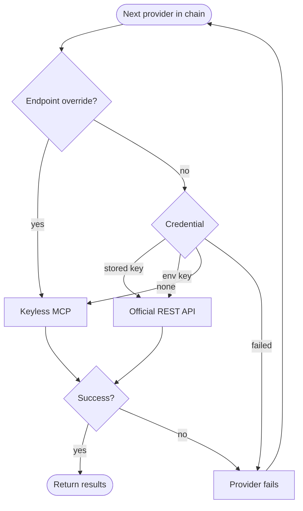

# pi-web-tools

Adds web search and fetch tools to [Pi](https://pi.dev) that work without an API key.

Without a key, search uses the free hosted endpoints that Exa and Parallel provide over MCP (Model Context Protocol). With a key, it uses that provider's official REST API instead.

## Install

```bash
pi install git:github.com/mich-murphy/pi-extensions
```

This loads every extension in the repository. To [load only some extensions](../../README.md#install), follow the root README.

## Usage

Ask Pi in plain language. The model picks the tool.

- "Search the web for the latest Node.js LTS release."
- "Fetch <https://example.com/docs> and summarize it."
- "Search with Brave for effect-ts layers, then fetch the best result."

## Tools

### `websearch`

Returns ranked results with title, URL and snippet. Each parameter is optional except `query`.

| Parameter | Type | Default | Effect |
| --- | --- | --- | --- |
| `query` | string | required | Search text. An empty query is rejected. |
| `maxResults` | number | `8` | Result count, rounded and clamped to 1–20. |
| `provider` | `exa`, `parallel` or `brave` | provider chain | Uses only that provider. It must be enabled. |

### `webfetch`

Fetches one public URL. Long text returns in windows of up to 50 KB or 2000 lines.

| Parameter | Type | Default | Effect |
| --- | --- | --- | --- |
| `url` | string | required | An `http://` or `https://` URL without credentials. |
| `format` | `markdown`, `text` or `html` | `markdown` | Output format. PNG, JPEG, GIF and WebP images return inline. |
| `timeout` | number | `30` | Seconds for the whole fetch, clamped to 1–120. |
| `offset` | integer | `0` | Byte offset into the converted text. Use the offset a truncated result names. Ignored for images. |

### Web tools in external subagents

A parent session having `websearch` and `webfetch` does not guarantee that a child has them. External subagent extensions such as `@gotgenes/pi-subagents` treat an agent's `tools` setting as the **complete allowlist**, not additions to inherited tools. Omitting the setting can select only built-in tools.

If a child reports that web tools are missing, check its agent definition and explicitly include both names alongside every other capability that child needs. For example, a project `.pi/agents/web-researcher.md` can contain:

```markdown
---
name: web-researcher
description: Research public sources with web tools
tools: read, bash, edit, write, grep, find, ls, websearch, webfetch
---
Research public sources and cite the pages you actually fetched.
```

This is an example full list, not a recommendation to grant file mutation or shell access to every researcher. Retain only the tools the task authorizes, following your subagent extension's configuration syntax. Start a new child after updating its definition and confirm that its available tools include both web tools. Renaming a tool, changing search providers or logging in cannot add a capability omitted by an external allowlist. Do not work around an intentional restriction with another tool.

## Configuration

Every setting is optional. Invalid values disable both tools and show an error at session start.

| Variable | Default | Effect |
| --- | --- | --- |
| `PI_WEB_TOOLS_PROVIDERS` | `exa,parallel` | Comma-separated search providers. Order sets priority. With the default, Brave is added last when a Brave key is available. |
| `PI_WEB_TOOLS_EXA_ENDPOINT` | `https://mcp.exa.ai/mcp` | Exa MCP endpoint. An override always uses keyless MCP and never receives a key. |
| `PI_WEB_TOOLS_PARALLEL_ENDPOINT` | `https://search.parallel.ai/mcp` | Parallel MCP endpoint. Same rule. |
| `PI_WEB_TOOLS_FETCH_RESCUE` | `on` | `off` disables provider-side fetch rescue. |
| `PI_WEB_TOOLS_FETCH_ALLOW_DOMAINS` | unset | Hostnames `webfetch` may reach. Subdomains match. Entries must be bare hostnames. |
| `PI_WEB_TOOLS_FETCH_DENY_DOMAINS` | unset | Hostnames `webfetch` must not reach. Wins over the allow list. |
| `EXA_API_KEY` | unset | Fallback Exa key. Switches Exa to the official REST API. |
| `PARALLEL_API_KEY` | unset | Fallback Parallel key. Switches search to the official REST API. |
| `BRAVE_API_KEY` | unset | Fallback Brave key. Enables Brave search. |

## Authentication

Keys are optional and unlock the official REST APIs. Run `/login pi-web-tools-exa`, `/login pi-web-tools-parallel` or `/login pi-web-tools-brave` and paste the key. `/logout` removes the stored key only; an environment key stays active.

Pi resolves a stored key first, then the environment variable. Changes apply to the next request without a restart. A stored `!command` key works, but Pi runs it synchronously and caches the result until you restart. See [design](docs/design.md#native-authentication).

## Provider chain

`websearch` tries each provider in order and returns the first success. A failed credential never falls back to that provider's keyless route.



Brave has no keyless route. Without a key it fails, and an explicit chain that includes Brave fails before searching.

## Limits

| Limit | Value |
| --- | --- |
| Direct fetch download | 10 MiB after decompression. Text over the cap is truncated and flagged. |
| Search provider response | 1 MiB. Larger responses fail. |
| Model-facing text window | 50 KB or 2000 lines |
| Codemode `content` window | 1 MiB |
| Redirects per fetch | 5 |
| Fetch deadline | 30 s default, 1–120 s per call, includes rescue |
| Search deadline | 25 s per provider, not for the whole chain |
| Credential resolution | 10 s per provider |
| `maxResults` | 1–20 |

## Codemode output

Pi's codemode lets the model call tools from a script. Both tools declare an output schema, so codemode scripts receive structured values. You can skip this section if you do not use codemode.

| Tool | Shape |
| --- | --- |
| `websearch` | `{ query, provider, results }`. Each result has `title`, `url` and, when supplied, `snippet`, `published_at`, `source`, `score`. |
| `webfetch` text | `{ url, status, mime_type, format, bytes, content, truncated, response_truncated, download_limit_bytes, full_output_path, via, offset, next_offset }`. Most fields are optional. |
| `webfetch` image | `{ type: "image", data, mimeType, note }` |

`next_offset` appears when the 1 MiB window cut the page. Loop while it is present and pass it as `offset`. `response_truncated` means the page hit the download cap, so counts from it are lower bounds. Rescued pages set `via` and omit `status` and `mime_type`. Failures throw.

## Limitations

- Fetch rescue: when a direct fetch is blocked (401, 403, 429) or returns an empty JS-only page, `webfetch` asks Exa or Parallel to fetch the page instead, which sends them the URL. It applies only to `markdown` and is off when an allow or deny list is set.
- Fetch follows redirects, which OWASP advises against. Every hop is checked against the same host and address policy. See [Redirects](docs/design.md#redirects).
- Every `offset` call downloads the page again.
- A stored `!command` key cannot be cancelled while it runs, and Pi caches its result until restart.
- HTTP 401 means the remote site requires authentication. `webfetch` does not use your browser login; use a public source or an authorized site-specific tool, never URL credentials. Logging in to a search provider does not log in to the target site.
- HTTP 404 means the remote site could not find the page. Check the URL or search for a current public source; it is not an extension crash.
- PDF and other unsupported binary files are not converted to text. Use an HTML/text version or provide extracted text; retrying the same PDF does not add conversion support.
- Never put credentials in queries or URLs.

## More

- [Design](docs/design.md): credentials, fetch safety, rescue, lifecycle.
- [Security policy](../../SECURITY.md)

Fetch-side architecture is adapted from [dmmulroy/pi-web-tools](https://github.com/dmmulroy/pi-web-tools) (MIT).
